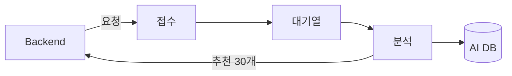

# profiling — 받는 사람 프로파일링 서버

받는 사람의 **비선호 카테고리 · 취향 문장 · 최근 리뷰**를 읽어 선물 **추천 상품 30개**를 골라 Backend 에 돌려주는 AI 서버입니다.

- Backend 가 요청을 보내면 바로 `202` 로 받고, 분석은 뒤에서 합니다.
- 끝나면 Backend 콜백 주소로 상품 번호 30개를 보냅니다.
- 취향 태그 · 리뷰 정리본은 AI DB 에만 저장하고, Backend 에는 상품 번호만 보냅니다.



| | |
|---|---|
| 상태 | **v2 개발 · 통합 중** (브랜치 `feat/v2-profiling-merge`) |
| 언어 · 런타임 | Python 3.13 · FastAPI · SQLAlchemy · Alembic · uv |
| 저장소 | PostgreSQL 16 + pgvector (마이그레이션 `0008`) |
| 외부 LLM | OpenRouter (태그 추출 — 꺼도 추천은 동작) |
| 담당 | AI 프로파일링 (Profile · Catalog · DB · Embedding 어댑터) |

## 목차

1. [빠른 시작](#1-빠른-시작)
2. [설정](#2-설정)
3. [API](#3-api)
4. [동작 방식](#4-동작-방식)
5. [프로젝트 구조](#5-프로젝트-구조)
6. [시험](#6-시험)
7. [배포](#7-배포)
8. [보안](#8-보안)

---

## 1. 빠른 시작

### 준비물

- Python 3.13 · [uv](https://docs.astral.sh/uv/)
- Docker (로컬 PostgreSQL)
- 프로파일링 담당에게 받을 것: **로컬 설정 템플릿**(`.env`) · **카탈로그 합본 파일**(팀 내부 자료 — 저장소 · 위키에 올리지 않음)

### 실행

```bash
cd profiling
cp <로컬 설정 템플릿> .env        # 계정 · 비밀번호 · 토큰 · DB 주소를 채운다
uv sync                          # 가상환경 + 의존성
docker compose up -d ai-db       # PostgreSQL 16 + pgvector
uv run alembic upgrade head      # 표 · 앱 전용 계정 만들기
uv run python -m tools.catalog.load_catalog --bundle <카탈로그 합본>.json.gz --if-empty
uv run uvicorn profiling.main:app --port 8000
```

확인:

```bash
curl localhost:8000/readyz       # {"ready": true, ...} 이면 요청을 받을 준비 완료
curl localhost:8000/health       # catalog.active · store.connected 가 true
```

> 외부 LLM 키가 없으면 태그 없이 돕니다(`/health` 의 `llm.state` 가 `off`). 추천 30개는 그대로 나옵니다.

### 컨테이너로 한 번에 (배포와 같은 모양)

```bash
docker compose up -d --build     # ai-db → ai-migrate(마이그레이션 한 번) → ai-app(:8000)
docker compose run --rm -v <합본 폴더>:/b:ro ai-migrate \
  python -m tools.catalog.load_catalog --bundle /b/<카탈로그 합본>.json.gz --if-empty
```

---

## 2. 설정

`.env` 는 저장소에 없습니다(예시 파일도 두지 않습니다). **계정 · 비밀번호 · 토큰 · DB 주소는 기본값이 없어**, 비어 있으면 compose · 마이그레이션 · 앱이 멈춥니다.

- 앱 설정의 정본: `src/profiling/settings.py` — 환경변수 이름은 `PROFILING_` + 필드 이름
- compose 만 읽는 값(로컬 DB 계정 등): `docker-compose.yml` 머리 주석

### 자주 쓰는 설정

| 환경변수 | 기본값 | 설명 |
|---|---|---|
| `PROFILING_DATABASE_URL` | 없음 (필수) | DB 주소. 앱은 앱 전용 계정, 마이그레이션 · 카탈로그 적재는 소유자 계정 |
| `PROFILING_SERVICE_TOKEN` | 빈 값 | Backend 와 같은 서비스 토큰. 비면 토큰 검사를 건너뜀 — **로컬 전용** |
| `PROFILING_BACKEND_BASE_URL` | `http://localhost:8081` | 콜백을 보낼 Backend 주소 |
| `PROFILING_CATALOG_SOURCE` | `file` | `db` = 배포 경로. `file` = 시험용 예시 카탈로그(가짜 상품 111개) |
| `PROFILING_TAGGER` | `none` | 태그 추출기 `none` · `openrouter` · `ollama` |
| `PROFILING_TAGGER_MODEL` | `gemma4:12b` | 추출기 모델 id (OpenRouter 를 쓰면 그 모델 id) |
| `PROFILING_TAGGER_TIMEOUT_S` | `120` | LLM 한 번 상한(초). **서버는 30** |
| `PROFILING_OPENROUTER_API_KEY` | 없음 | OpenRouter 키. `.env` 에만 둔다 |
| `PROFILING_TAG_SPEC` | `tag3` | 태그 규격 — `tag3`(카테고리 · IP · 브랜드) / `tag4`(+ 특징) |
| `PROFILING_EMBEDDING_DIR` | 없음 | 검색(product-search) 폴더. 주면 태그로 비슷한 상품을 찾는 단계가 켜진다 |
| `PROFILING_DISLIKE_MODE` | `exclude` | 비선호 카테고리 `exclude`(빼기) / `penalty`(감점) |
| `PROFILING_SLOTS` | `1` (compose · 서버 `8`) | 동시 분석 수 |
| `PROFILING_QUEUE_MAX` | `200` | 대기열 상한. 넘으면 `503` |
| `PROFILING_SHUTDOWN_DRAIN_S` | `5` (서버 `35`) | 종료할 때 진행 중 분석을 기다리는 최대 초 |
| `PROFILING_STRICT_STARTUP` | `false` (서버 `true`) | 서버용 기동 검사 — [보안](#8-보안) |
| `PROFILING_DB_REFUSE_SUPERUSER` | `false` (compose · 서버 `true`) | 슈퍼유저로 접속하면 기동 거부 |

마이그레이션만 읽는 값: `PROFILING_APP_DB_ROLE`(앱 전용 계정 이름) · `PROFILING_APP_DB_PASSWORD`(그 비밀번호). 셸 환경변수가 없으면 같은 `.env` 에서 읽는다.

DB 연결 수 · 시간 상한 · 재시도 같은 나머지 설정은 `settings.py` 의 설명을 봅니다.

---

## 3. API

| 메서드 · 경로 | 누가 부르나 | 설명 |
|---|---|---|
| `POST /api/internal/v1/ai/profile/extract-and-pool` | Backend | 분석 요청. 바로 `202 PENDING`. 서비스 토큰 필요 |
| `GET /health` | Backend (요청 전 매번) | 상태 전부. Backend 는 `catalog.active` · `store.connected` 만 본다 — **이름 · 뜻을 바꾸지 않는다** |
| `GET /healthz` | ECS Liveness | 프로세스가 살아 있으면 늘 `200` |
| `GET /readyz` | ECS Readiness | 카탈로그 · DB · 마이그레이션 판이 준비되면 `200`, 아니면 `503`. 외부 LLM 은 보지 않는다 |

**분석 요청의 응답 코드**

| 코드 | 언제 |
|---|---|
| `202` | 받음 (분석은 뒤에서) |
| `400` | 본문 형식 위반 (리뷰 11개 이상 등) |
| `401` | 서비스 토큰 틀림 |
| `503` | 카탈로그 없음(`Retry-After: 300`) · 대기열 가득(`Retry-After: 30`) |

**콜백** — 분석이 끝나면 Backend 에 상품 번호(최대 30개)와 요청 번호(`sourceVersion`)를 보냅니다. 태그는 보내지 않습니다.

| Backend 응답 | AI 쪽 기록 |
|---|---|
| `200` | 전달 완료 |
| `409` | 더 새 요청이 있어 이 결과는 버려짐 |
| `4xx` | 실패 (다시 보내지 않음 — Backend 가 나중에 다시 요청) |
| `5xx` · 네트워크 오류 | 최대 3번까지 시도 |

---

## 4. 동작 방식

요청 한 건은 이렇게 처리됩니다.

1. **접수** — 본문 · 토큰 검사 → 대기열에 넣고 `202`.
2. **중복 판정** — 같은 받는 사람 · 같은 요청 번호면, 이미 결과가 있을 때 다시 분석하지 않고 결과만 다시 보냅니다. 분석 중이면 아무것도 하지 않습니다.
3. **분석**
   1. 리뷰 별점으로 소분류별 선호 점수를 쌓습니다.
   2. 취향 문장 · 좋게 준 리뷰(4~5점)가 있으면 **태그를 뽑습니다.**
      - 가드레일: 개인정보 · 욕설은 가리고, 의미 없는 글 · 프롬프트 공격 의심 글은 버립니다.
      - LLM 을 한 번 부르고, 검증기가 근거 없는 태그 · 판촉 단어 · 문장형 태그를 버립니다.
      - LLM 이 실패해도 요청은 실패하지 않습니다(태그 없이 계속).
   3. **추천 30개를 고릅니다.**
      - 비선호 카테고리 상품과 이미 리뷰한 상품은 뺍니다.
      - 한 소분류는 최대 10개, 같은 모델은 하나만 넣습니다.
      - 태그가 있고 임베딩이 켜져 있으면 태그와 비슷한 상품을 골고루 섞습니다.
      - 입력 세 칸이 모두 비어 있으면 0개를 보냅니다(Backend 가 인기순으로 대체).
   4. 결과와 받는 사람 프로필을 저장합니다. **원문은 저장하지 않고 가드레일 정리본만** 둡니다.
4. **콜백** — Backend 로 30개를 보냅니다.

로그에는 리뷰 글 · 취향 문장 · LLM 출력 원문을 남기지 않습니다. 번호 · 개수 · 상태 · 비용만 남깁니다.

---

## 5. 프로젝트 구조

```
profiling/
├── src/profiling/
│   ├── main.py          앱 조립 · 기동 검사 · /health · /healthz · /readyz
│   ├── intake.py        요청 접수 · 토큰 · 중복 판정 · 콜백 보내기
│   ├── supervisor.py    동시 분석 슬롯 + 대기열
│   ├── pipeline.py      한 건 분석 (점수 → 태그 → 30개 → 저장)
│   ├── selection.py     추천 30개 고르기
│   ├── tagging.py       태그 규격 · 프롬프트 · 검증기
│   ├── prompts/         태그 규격별 시스템 프롬프트
│   ├── guard.py         입력 가드레일
│   ├── llm.py           외부 LLM 어댑터 (OpenRouter · Ollama)
│   ├── embedding.py     상품 벡터 · 질의 인코더 어댑터
│   ├── catalog.py       카탈로그 읽기 (DB · 파일)
│   ├── stores.py        PostgreSQL 저장소
│   ├── backend.py       Backend 콜백 어댑터
│   ├── changes.py       프로필이 무엇이 바뀌었는지 요약 로그
│   ├── status.py        외부 LLM 상태 (/health 의 llm 칸)
│   ├── schemas.py       HTTP 본문 (camelCase)
│   ├── types.py         내부 타입 (snake_case)
│   ├── ports.py         바깥 의존의 인터페이스
│   └── settings.py      설정 (PROFILING_*)
├── alembic/versions/    DB 마이그레이션 (0001 ~ 0008)
├── tools/catalog/       운영 CLI — 카탈로그 적재 (이미지에 들어가는 유일한 도구)
├── tests/
│   ├── unit/            DB · 네트워크 · LLM 없이
│   ├── integration/     진짜 PostgreSQL (DB 주소가 없으면 건너뜀)
│   └── fixtures/        시험용 가짜 카탈로그
├── Dockerfile
└── docker-compose.yml
```

**설계 규칙**

- **Ports & Adapters** — 업무 코드(`pipeline` · `selection` · `tagging`)는 HTTP · DB · LLM 을 모릅니다. 바깥은 `ports.py` 모양에 맞춰 들어옵니다. 그래서 단위 시험은 가짜 구현만으로 돕니다.
- **이름** — HTTP 경계(`schemas.py`)만 camelCase, 나머지는 snake_case. 변환은 `pipeline.to_internal()` · `backend.to_callback()` 두 곳뿐입니다.
- **태그 규격** — `PROFILING_TAG_SPEC` 하나로 축 · 프롬프트 · JSON 스키마가 같이 바뀝니다. 프롬프트 파일의 축이 규격과 다르면 서버가 뜨지 않습니다.
- **DB 표 구조** — 팀 위키의 DB ERD 문서를 봅니다.

---

## 6. 시험

```bash
uv run pytest -q                              # 전체 (DB 주소가 없으면 통합 시험은 건너뜀)
uv run pytest -q tests/unit                   # 단위만
uv run ruff check src tests tools alembic     # 린트
```

시험은 `.env` 에서 **DB 주소 · 앱 계정 이름만** 읽고 나머지 설정은 코드 기본값으로 돈다(개발자 `.env` 의 토큰 · 추출기 값이 시험을 바꾸지 않게 — `tests/conftest.py`).

| 묶음 | 무엇을 보나 | 필요한 것 |
|---|---|---|
| `tests/unit` (315개) | 업무 규칙 · 어댑터(가짜 HTTP) · 설정 · 기동 검사 | 없음 |
| `tests/integration` (80개) | 마이그레이션 · 저장소 · 앱 끝에서 끝 | PostgreSQL (`PROFILING_DATABASE_URL`) |

실험 도구(시험 장치 · 부하 시험 · 모델 비교 · 가짜 Backend)는 이 브랜치에 없습니다. 필요하면 프로파일링 담당에게 요청합니다.

---

## 7. 배포

순서: **마이그레이션 → 카탈로그 적재 → 앱.** 카탈로그가 없으면 `/readyz` 가 `503` 이라 앱 배포가 끝나지 않습니다.

```bash
alembic upgrade head                                                     # 마이그레이션 Task (소유자 계정)
python -m tools.catalog.load_catalog --bundle s3://<버킷>/<키> --if-empty  # 적재 Task — 이미 있으면 건너뜀
uvicorn profiling.main:app --host 0.0.0.0 --port 8000                    # 앱 (이미지 기본 명령)
```

| 항목 | 값 |
|---|---|
| 포트 | 8000 |
| 헬스 체크 | Liveness `/healthz` · Readiness `/readyz` |
| 권장 자원 | `cpu` 256 · `memoryReservation` 256 MiB · `memory` 512 MiB |
| 종료 유예 | `PROFILING_SHUTDOWN_DRAIN_S=35` · 컨테이너 `stopTimeout` 60 |
| 동시 분석 | `PROFILING_SLOTS=8` (DB 연결은 Task 당 14) |
| 카탈로그 합본 | **비공개** S3 (팀 내부 자료) |

- 새 마이그레이션을 더하면 `main.EXPECTED_MIGRATION` 도 같은 커밋에서 올립니다. 다음 번호는 `0009`.
- 배포 중에는 옛 코드도 새 표에서 돌아야 하므로 **열 추가 → 코드 → 삭제는 다음 판** 순서로 씁니다.
- 이미지에는 `src/` · `alembic/` · `tools/catalog/` 만 들어갑니다. 시험 · 문서 · `.env` 는 들어가지 않습니다. 비루트 사용자로 돕니다.

---

## 8. 보안

- **비밀 값** — 키 · 토큰 · 계정 · 비밀번호는 저장소에 두지 않습니다. 로컬은 `profiling/.env`, 서버는 Secrets Manager.
- **기동 검사(`PROFILING_STRICT_STARTUP=true`, 서버 필수)** — 아래 중 하나라도 해당하면 서버가 뜨지 않습니다. 로그에는 어느 설정인지만 나오고 값은 나오지 않습니다.
  - DB 마이그레이션 판이 코드보다 낮음
  - 서비스 토큰 · DB 계정 이름 · DB 비밀번호가 비었거나 공개된 로컬 값
  - Backend 주소가 로컬 기본값
  - 카탈로그를 DB 에서 읽지 않음
- **DB 권한** — 앱은 앱 전용 계정으로 접속합니다(프로필 표 읽기 · 쓰기, 카탈로그 표 읽기만). 슈퍼유저 접속은 막습니다.
- **개인정보** — 리뷰 · 취향 원문은 저장하지 않고 로그에도 남기지 않습니다. LLM 에는 가드레일을 거친 글만 보냅니다. LLM 추적 도구는 운영에서 쓰지 않습니다.
- **OpenRouter 키** — 요청 헤더로만 보내고 로그 · 예외 메시지에 남기지 않습니다.
