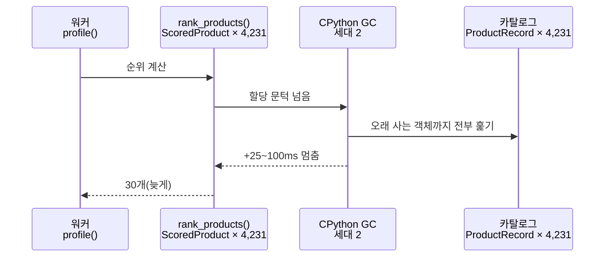
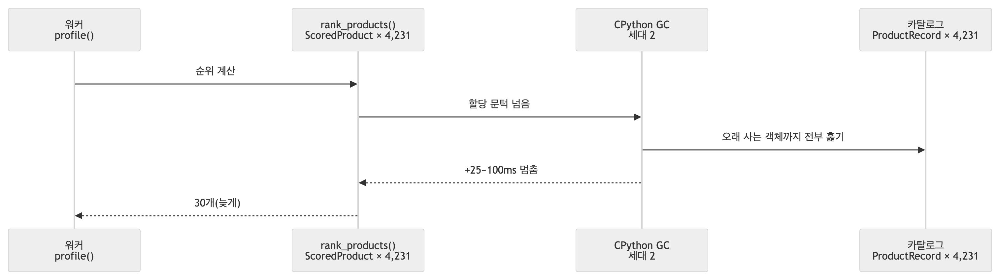

# 순위 계산 중 세대 2 GC 로 서버 처리 꼬리 지연(p95 13ms → 36ms)

| | |
|---|---|
| 발견 | 2026-10-12 08:15 · 시험 결과 보고서용 백분위 측정(30개 콜백 검증 10회 반복 · 앱만 띄워 7.6 200건) 중 p90 → p95 가 계단처럼 뛰는 것을 보고 GC 를 끄고 대조 |
| 대상 코드 | `src/profiling/pipeline.py` `rank_products()`(요청마다 후보 4,231개의 `ScoredProduct` 생성) · `src/profiling/catalog.py` `DbCatalogReader._load()`(카탈로그 `ProductRecord` 4,231개를 프로세스 내내 보관) · `src/profiling/main.py` `lifespan` |
| 상태 | **해결 · 미커밋**(10-12) — `catalog._freeze_long_lived()` 를 `DbCatalogReader._load()` 끝에서 호출 · 시험 `test_catalog_is_frozen_out_of_gc_and_reload_does_not_pile_up` |
| 심각도 | 🟡 — 기능 영향 없음. 7.6 은 비동기라 BE 202 응답(p95 1.5ms)엔 영향 없고 7.7 콜백까지 시간 · 워커 슬롯 점유만 늘어남 |

## 문제 정의

요청 약 5~6% 가 서버 처리에 25~100ms 를 더 쓴다. 특정 사용자 · 순서와 무관하다(30개 콜백 검증 200건 중 느린 13건이 10명 · 여러 순서에 흩어짐). GC 를 끄면 사라진다.

**앱만 띄운 측정**(TestClient · 7.6 순서대로 200건 · 감점 모드 · DB 카탈로그 4,231개, 하네스 계산 없음)

| GC | 세대 2 수집 | 서버 처리 p75 / p90 / **p95** / p99 · 최대 | 콜백까지 p95 | 40ms 넘는 요청 |
|---|---|---|---|---|
| 기본 | 13 | 12.8 / 14.8 / **35.9** / 45.0 · 60.1 | 37.7 | 6 |
| `gc.freeze()`(카탈로그 로드 직후) | 13 | 12.2 / 13.0 / **13.7** / 18.7 · 44.4 | 17.0 | 1 |
| 끔(대조군) | 0 | 11.7 / 12.6 / **12.9** / 16.3 · 22.1 | 16.5 | 0 |

**30개 콜백 검증 10회 반복**(하네스가 사람마다 순위 전체를 보관해 힙이 큼): 기본 서버 p95 67.3ms · 느린 요청 11 → GC 끔 13.3ms · 0. 여기서는 `gc.freeze()` 가 효과 없었다(하네스가 실행마다 앱 · 카탈로그를 새로 만들고, 결과 객체를 계속 쌓기 때문 — 운영 조건이 아님).

## 문제 원인

CPython 의 세대 2 GC 는 추적 대상 객체 **전체**를 훑는다. 카탈로그 `ProductRecord` 4,231개(필드마다 문자열 · datetime 객체)는 프로세스 내내 살아 있어 세대 2 에 쌓이고, 요청마다 `rank_products` 가 `ScoredProduct` 4,231개 + 정렬용 튜플을 만들어 할당 수가 많다 → 세대 2 수집이 주기적으로 일어날 때마다 오래 사는 카탈로그까지 다시 훑어 수십 ms 가 걸린다. "4천 개쯤은 메모리에 들고 있어도 된다"는 가정(DbCatalogReader 설계)이 GC 비용은 따지지 않았다.

## 연관된 기능

- 7.7 콜백까지 시간 · 워커 슬롯 점유(Supervisor 슬롯이 그만큼 오래 잡힘). 몰아 보내기 처리량(10-11 291건/s)에 꼬리만큼 영향.
- 지금 안 보이는 이유: 기존 측정이 p50 · 소표본(20~30건)이라 p95 가 최댓값 하나에 묻혔다. 카탈로그가 커지거나(상품 증가) 요청이 몰리면 더 드러난다.
- 임베딩 경로(D)를 넣으면 벡터 · 후보 배열이 더해져 같은 현상이 커질 수 있다(D 순위 계산도 p95 59~75ms, GC 끔 29ms).

## 문제 그림

<!-- fig: 01-gc-꼬리 -->

## 예상 해결책

1. **카탈로그 로드 직후 `gc.collect(); gc.freeze()`** — `DbCatalogReader._load()` 끝(새 카탈로그로 바꾼 뒤)에서. 오래 사는 카탈로그를 영구 세대로 옮겨 세대 2 가 훑지 않게 한다. 실측 p95 35.9 → 13.7ms. 카탈로그가 바뀌면 옛 객체는 freeze 된 채 남으므로 `gc.unfreeze()` → 교체 → `gc.collect(); gc.freeze()` 순서로.
2. (대안) `gc.set_threshold` 로 세대 2 빈도 낮추기 — 전역 영향이 커서 1 보다 후순위.
3. (근본) `rank_products` 의 객체 생성 줄이기 — 점수 계산을 배열(numpy)로, `ScoredProduct` 는 앞 N 개만 만들기.
4. 고정할 시험: 부하 하네스(`tools/loadtest`)에 p95 · p99 출력 추가, 앱만 띄운 200건 측정을 도구로(`tools/` 아래) 남겨 회귀 확인.
5. 손볼 문서: 코드 안내서(DbCatalogReader) · 시험 결과 보고서 §2.3 · 파이프라인 지도 다음 판.

## 반영 결과(10-12)

`tools/bench/percentiles.py` — 앱만 7.6 200건, 조건마다 새 프로세스. "반영 전"은 지금 코드에서 카탈로그 로드 뒤 `gc.unfreeze()` 로 재현.

| 서버 처리(ms) | p75 | p90 | p95 | p99 | 최대 |
|---|---|---|---|---|---|
| 반영 전 | 9.6 | 10.2 | 25.9 | 28.4 | 29.6 |
| **반영 후** | 8.9 | 9.4 | **9.9** | 10.7 | 11.2 |
| GC 끔(대조) | 8.3 | 9.5 | 10.3 | 12.9 | 16.9 |

30개 콜백 하네스 10회(200건) 서버 처리 p95 76.6 → 14.3ms. 해결책 3(객체 생성 줄이기)은 남겨 둠 — 세대 2 수집 횟수(13회)는 그대로이고 한 번이 가벼워진 것이다.
