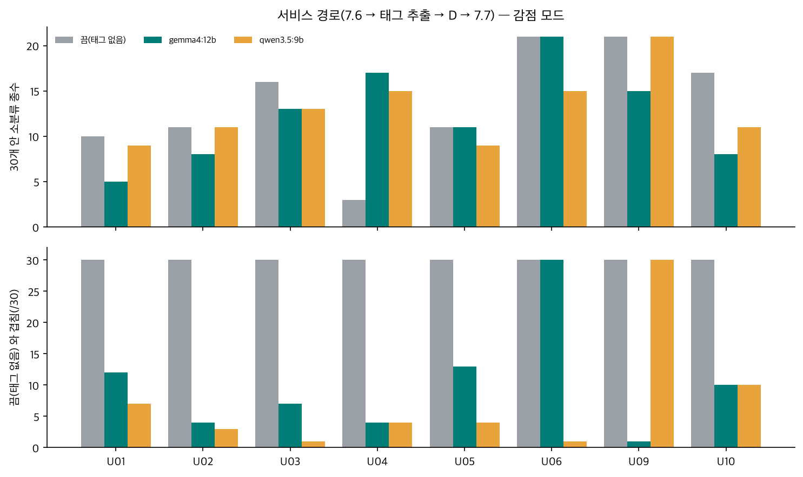
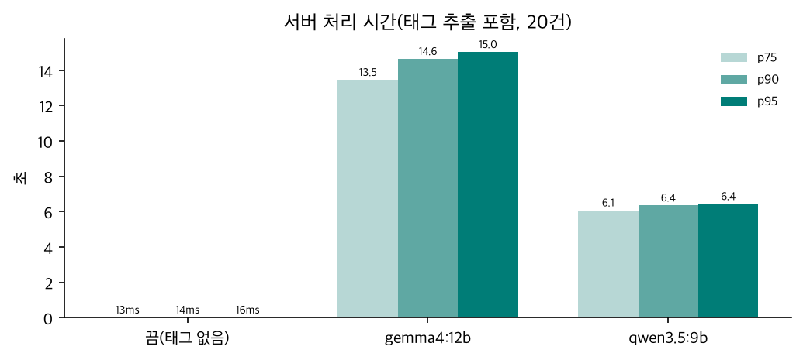

# 로컬 LLM 서비스 경로 시험 결과 (2026-10-12)

| | |
|---|---|
| 무엇 | 로컬 LLM 태그 추출을 **서비스 코드 안에서** 돌린 첫 시험 — 7.6 → `pipeline.profile()` → LLM 태그 추출(Ollama) → 검증기 → 풀 고르기 D(임베딩 단계 켜짐) → DB 저장 → 7.7 |
| 대상 코드 | `feat/v2-profiling-init` @ `a637e45` + 작업 트리(D 코어 · `tagging` · `llm` · `embedding` 어댑터, **미커밋**) |
| 하네스 | 30개 콜백 검증 `tools/scenario_callback30` — `--tagger ollama --tagger-model <모델> --embedding-dir product-search` (앱 전체 · 진짜 7.7 요청) |
| 모델 | 태그 추출 **`gemma4:12b`**(Q4_K_M) · **`qwen3.5:9b`** — Ollama · temperature 0 · seed 42 · 생각 끔 · 프롬프트 `tag4-2fc950d4` / 임베딩 `jina-embeddings-v5-text-nano-retrieval`(q4f16, CC BY-NC) |
| 기준 | 같은 하네스, 태그 추출 끔(D 가 태그 없이 — 비선호 하드 제외 · 한 소분류 최대 10 · 모델 코드 중복 제거) |
| 결과 한 줄 | **gemma4:12b 는 368/368 전부 통과**(시나리오 기대 포함), 서버 처리 p95 15.0초. **qwen3.5:9b 는 자동 검사는 전부 통과했지만 시나리오 기대 6개 실패** — 태그가 범용 특징 위주라 5점 소분류 신호를 잃었다. 서비스 경로의 태그는 실험 도구 추출과 **완전히 같다**(같은 프롬프트 · 결정성) |

---

## 1. 무엇을 만들었나

| 조각 | 위치 | 역할 |
|---|---|---|
| 프롬프트 · 검증기 | `src/profiling/tagging.py` | 실험 도구의 프롬프트(해시 `2fc950d4`)를 코어로 옮김 — 도구와 서비스가 한 구현. `build_prompt` 가 만든 프롬프트가 10-12 로컬 모델 비교 때와 10/10 동일 |
| LLM 어댑터 | `src/profiling/llm.py` `OllamaTagExtractor` | `ports.TagExtractor` 구현. 앱 시작 때 모델을 올려 둠(warm_up) |
| 임베딩 어댑터 | `src/profiling/embedding.py` `ProductSearchEmbedding` | `ports.EmbeddingIndex` 구현 — product-search 상품 벡터 + Node 질의 인코더, BE 번호로 연결 |
| 파이프라인 | `pipeline.profile()` · `_extract_tags()` | 취향 · 리뷰가 있으면 LLM 한 번 → 검증기 → 태그를 D 에 넘김. **LLM 이 실패해도 요청은 계속**(태그 없이 D). 원문은 로그에 남지 않음 |
| 설정 | `PROFILING_TAGGER`(none · ollama) · `TAGGER_MODEL` · `OLLAMA_URL` · `TAGGER_TIMEOUT_S` · `EMBEDDING_DIR` | **기본은 꺼짐** — 켜지 않으면 동작이 이전과 같다 |

## 2. 결과표 — 요약(20건 = 10명 × 제외 · 감점)

| 구성 | 검사 | 태그 있는 사람 | 태그 수 | 소분류 종수 평균(태그 있는 사람) | 한 소분류 최다 | 비선호 | 끔과 겹침 평균(/30) | 서버 처리 p75 · p90 · p95 |
|---|---|---|---|---|---|---|---|---|
| 끔(태그 없음) | 350/350 | 0 | 0 | — | 10 | 0 | 30 | 13 · 15 · 16 ms |
| **gemma4:12b** | **368/368** | 7 | 19 | 11.0 | 10 | 0 | **7.3** | **13.5 · 14.6 · 15.0 초** |
| qwen3.5:9b | 362/368 | 7 | 13 | 11.9 | 10 | 0 | 4.3 | 6.1 · 6.4 · 6.4 초 |

검사 368 = 기본 350 + "저장된 태그 = 같은 원출력을 검증기로 다시 만든 태그" 18건(LLM 이 불린 9명 × 2모드).



## 3. 결과표 — 사람별(감점 모드)

| 사람 | gemma4:12b 태그 | 종수 / 최다 | 끔과 겹침 | qwen3.5:9b 태그 | 종수 / 최다 | 끔과 겹침 |
|---|---|---|---|---|---|---|
| U01 뷰티 | 특징:은은한 향 · 향수 | 5 / 향수 10 | 12 | 특징:은은한 향 · 특징:산뜻함 | 9 / 향수 10 | 7 |
| U02 디지털 | 특징:노이즈캔슬링 · 헤드폰 · 노트북 거치대 | 8 / 모바일·PC 10 | 4 | 특징:노이즈캔슬링 · 특징:튼튼함 | 11 / 영상·음향 10 | 3 **✗** |
| U03 신생아 | 출산선물세트 · 특징:부드러운 소재 · 특징:백색소음 | 13 / 출산·육아 10 | 7 | 특징:부드러운 소재 · 특징:잠자기 좋은 기능 | 13 / 출산·육아 5 | 1 **✗** |
| U04 캐릭터 | IP:춘식이 · IP:한교동 · IP:산리오 | **17** / 차량용품 4 | 4 | IP:춘식이 · IP:한교동 | 15 / 패션소품 4 | 4 |
| U05 홈카페 | 특징:달달한 디저트 · 커피 · 케이크 · 차 선물세트 | 11 / 커피·차 10 | 13 | 디저트 · 커피 · 차 | 9 / 커피·차 10 | 4 |
| U06 콜드 스타트 | (없음) | 21 / 3 | 30 | 특징:실용적 | 15 / 6 | 1 **✗** |
| U07 · U08 | (없음 — U08 은 LLM 미호출) | 21 · 15 | 30 | (없음) | 21 · 15 | 30 |
| U09 비선호 vs 리뷰 | 브랜드:조말론런던 · 향수 | 15 / 홈프래그런스 9 | 1 | **(없음 — 놓침)** | 21 / 3 | 30 |
| U10 엣지 | 브랜드:소니 · 헤드폰 | 8 / 영상·음향 10 | 10 | 특징:노이즈캔슬링 | 11 / 영상·음향 10 | 10 |

✗ = 시나리오 기대 실패(제외 · 감점 모드 각각 → 모두 6개).



## 4. 분석

### 4.1 서비스 경로가 실험과 같은가 — 같다

- **태그가 실험 도구 추출과 완전히 같다**(gemma 19개 · qwen 13개, 사람별 동일). 프롬프트가 같고(10/10) temperature 0 · seed 고정이라, 도구로 본 결과를 서비스가 그대로 재현한다.
- 저장된 프로필 태그 = 원출력을 검증기로 다시 만든 태그 — 18/18(두 모델 모두).
- **콜백 30 = 실행 기록 30 = 같은 입력으로 코드가 고른 30** — 40/40. LLM 이 끼어도 같은 입력 = 같은 결과(재전송 · 중복 판정 전제)가 지켜진다.

### 4.2 gemma4:12b — 품질은 기대대로, 대가는 시간과 인기

- **시나리오 기대 전부 통과** — 5점 소분류가 상위 10 안(U01 · U02 · U04 · U05), 1~2점 소분류 30개 밖, 비선호 0, U09 는 뷰티 0 · 생활 향 제품 9.
- **태그가 결과를 크게 바꾼다** — 끔과 겹침 평균 7.3/30. U04 는 IP 태그로 소분류 3종 → 17종(차량용품 · 패션소품 등에 흩어진 캐릭터 상품).
- **대신 좁아지는 사람도 있다** — U01 은 10종 → 5종. 태그 둘(향수 · 은은한 향)이 모두 향 쪽이라 후보가 향수 · 바디 · 홈프래그런스에 몰린다. 취향 반영 ↑ · 다양성 ↓ 의 교환.
- **인기가 내려간다** — 30개의 조회수 백분위 평균이 끔 0.94~1.00 → gemma 0.71~0.93. 후보가 태그 근처로 한정되기 때문(실험 결과와 같은 경향).

### 4.3 qwen3.5:9b — 빠르지만 신호를 잃는다

- **품목 · 브랜드 태그가 거의 없다**(13개 중 특징 8). "튼튼함" · "산뜻함" · "잠자기 좋은 기능"처럼 거의 모든 상품에 맞는 특징이 질의가 되자,
  - U02: 5점 준 모바일·PC 가 상위 10 에서 사라짐(✗)
  - U03: 출산·육아가 상위 10 중 3개로(기대 5개 이상, ✗) — 소분류 종수도 끔보다 적고 출산·육아 최다도 5 로 낮아졌다
  - U06: "실용적" 하나로 30개 중 29개가 바뀜(✗ — 이 기대는 "태그 없는 콜드 스타트 = 조회수순"을 전제로 썼다. 모호한 태그가 생긴 것 자체가 문제)
- **U09 를 놓쳐** 태그 없이 돌았다 — 결과는 끔과 같다(뷰티 0 은 지켜짐).
- 시간은 gemma 의 절반(p95 6.4초).

### 4.4 시간 · 운영

| 구간 | 값 | 뜻 |
|---|---|---|
| 서버 처리(LLM 포함) | gemma p95 15.0초 · qwen p95 6.4초 · 끔 16ms | 약 1,000배. 7.6 은 비동기라 BE 202(수 ms)는 그대로 |
| LLM 미호출 | U08(입력 없음) 0.0초 | 취향 · 리뷰가 없으면 LLM 을 부르지 않는다 |
| 출력이 짧을 때 | U06 · U07 2~4초 | 시간은 출력 토큰 수에 비례(10-12 측정) |
| 처리량 | 슬롯 1개면 사람당 ~13초 → 시간당 약 270명 | 몰리면 큐(QUEUE_MAX)가 찬다 — 슬롯 수 · 큐 상한 · BE PENDING 타임아웃(10분)과 같이 봐야 함 |

### 4.5 이번에 찾은 것

| # | 내용 | 원인 | 처리 |
|---|---|---|---|
| S1 | 첫 실행에서 하네스 재현성 검사 8건 실패 | **DB 프로필에 `prompt_version` · 태그 축(axes)이 저장되지 않는다** — 10-08 결정으로 0006(LLM 단계)으로 미룬 열. 하네스가 저장 프로필에서 태그를 다시 만들 때 특징 축이 사라져 가중이 달라짐 | 하네스는 LLM 원출력을 기록해 같은 검증기로 다시 만들게 고침(→ 통과). **서비스 쪽 공백은 그대로** — 0006 마이그레이션 필요(결정 사항) |
| S2 | qwen 시나리오 기대 6개 실패 | 4.3 — 범용 특징 태그 | 프롬프트 보강 또는 gemma 선택 |
| S3 | 시나리오 기대 일부가 "태그 없는 세계" 전제 | U06 조회수순 · U03 상위 10 중 5개 등은 LLM 이전에 썼다 | LLM 을 켠 기준선이 정해지면 기대를 나눠 적기(태그 끔 / 켬) |

## 5. 결론과 다음

1. **서비스에 LLM 태그 추출을 붙이는 구조는 동작한다** — 결정성 · 계약 · 저장 · 실패 시 대체까지 시험으로 확인.
2. **모델은 gemma4:12b 를 기본으로 권한다**(설정 기본값도 gemma4:12b). qwen3.5:9b 는 빠르지만 품목 · 브랜드를 놓쳐 추천이 사용자의 5점 신호에서 멀어진다.
3. 다음:
   - **0006 마이그레이션** — `prompt_version` · 4축 태그(axes) 저장(채팅이 태그 축을 알려면 필요). 공유 로컬 DB 를 콜백 브랜치도 쓰므로 순서 협의 필요
   - **프롬프트 보강** — "리뷰 상품의 품목 · 브랜드를 먼저" · "거의 모든 상품에 맞는 특징은 내지 않는다"(U06 · qwen) → 같은 하네스로 재측정
   - **운영 값** — 슬롯 수 · `TAGGER_TIMEOUT_S`(120초) · 큐 상한을 LLM 시간 기준으로 다시
   - **임베딩 모델 라이선스(CC BY-NC)** 확인 — 서비스 반영 전 필수

## 6. 재현

```bash
cd profiling
uv run python -m tools.scenario_callback30.run                                        # 끔(기준)
uv run python -m tools.scenario_callback30.run --tagger ollama --tagger-model gemma4:12b \
  --embedding-dir ../product-search
uv run python -m tools.scenario_callback30.run --tagger ollama --tagger-model qwen3.5:9b --embedding-dir ../product-search
uv run --with matplotlib python -m tools.bench.llm_service_report <끔.json> <gemma.json> <qwen.json>   # 이 문서의 표 · 그래프
```

원자료: `tools/scenario_callback30/out/시나리오_결과_20261012_110152 · 110516 · 110647.{json,xlsx}` · `tools/bench/out/llm_service_20261012_110710.json`(커밋 안 함).
