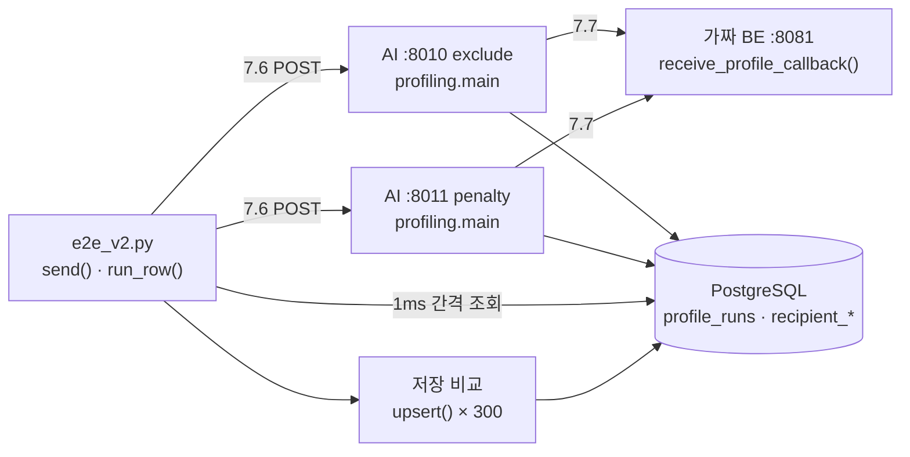
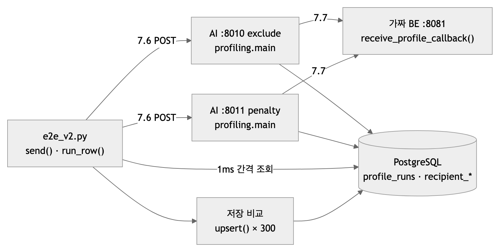
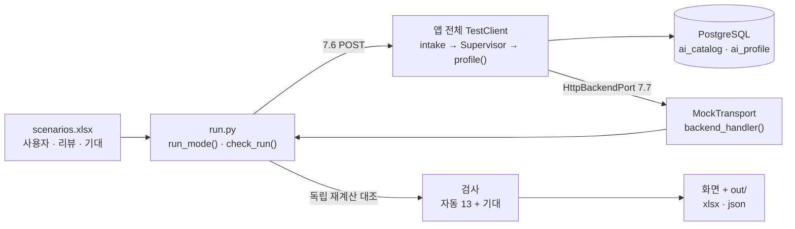
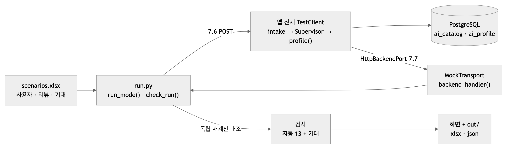

# 프로파일링 코어 검증 결과 — 두 하네스와 인기 정규화 변경 비교 (2026-10-12)

| | |
|---|---|
| 대상 코드 | 브랜치 `feat/v2-profiling-init` @ `c11f76c` + 작업 트리(인기 순위 백분위 · `rank_products` · 시나리오 하네스, **미커밋**) |
| 하네스 | ① 로컬 실측(10-11) — 서버를 띄워 시간 측정 ② 30개 상품 콜백 검증(10-12) — 가상 수신자 10명 시나리오 |
| 결과 한 줄 | 두 하네스 모두 검사 통과(① 실패 0 · ② 300/300). **인기를 순위 백분위로 바꿔도 30개는 그대로였고, 5점 소분류가 30개를 독차지하는 문제는 남았다** — 원인은 정규화가 아니라 편향 크기 대비 "30개"의 선택성. 고칠 방법 두 가지를 시뮬레이션했다(§4) |
| 데이터 | DB 카탈로그 `ai_catalog` 4,231건(BE 번호 · 재고 전부 available · 조회수 102~49,989, 중앙값 24,826 — BE 가 넣은 임의값) · LLM 호출 없음 |

---

## 1. 하네스 ① — 로컬 실측(시간 측정)

서버를 실제로 띄우고 HTTP 로 7.6 을 보내 시간을 잰다. 두 비선호 모드를 동시에 비교한다.

<!-- fig: 01-로컬실측-하네스 -->




| 무엇을 재나 | 방법 |
|---|---|
| 202 | POST 직전 → 202 응답 |
| 7.6 → DELIVERED | POST 직전 → `profile_runs.status = DELIVERED`(1ms 간격 확인) |
| 서버 처리 | `profile_runs.updated_at − created_at` |
| 저장 1회 | 리뷰 10개 프로필 `upsert()` 300회 — CTE 한 문장(잠금 커넥션 · 풀 커넥션) vs 트랜잭션 세 문장 |

**결과(10-11, 실패 0):** 리뷰 2개 요청 서버 처리 p50 2.1ms · 7.6 → DELIVERED p50 5.3ms · 몰아 보내기 40건 291건/s · 저장 1회 CTE·잠금 커넥션 p50 0.4ms vs 세 문장 0.9ms · DB·로그에 원문 없음. 자세한 표는 [파이프라인 지도 10-11 §3](파이프라인_지도/2026-10-11.md).

## 2. 하네스 ② — 30개 상품 콜백 검증(시나리오)

가상 수신자를 엑셀로 넣고, 앱 전체를 서버 없이 띄워 **입력 → 점수 → 30개 → 7.7 콜백**을 한 번에 보고 검사한다. 절차는 [tools/scenario_callback30/README.md](../tools/scenario_callback30/README.md).

<!-- fig: 02-콜백30-하네스 -->




**가상 수신자 10명:** 뷰티 러버 · 디지털 얼리어답터 · 신생아 부모 · 캐릭터 덕후 · 홈카페 · 콜드 스타트(리뷰 없음) · 까다로운 사람(1~2점) · 비선호 꽉 채움(5개) · 비선호 vs 리뷰 충돌 · 엣지 입력(중복 · 없는 상품 · 3점 · 이름만 맞는 비선호). 두 모드(exclude · penalty) → 20건.

**자동 검사(실행마다 13개):** 7.6 202 · 7.7 콜백 1회·경로·토큰 · 본문 계약(모르는 필드 금지) · 개수·중복 · 카탈로그·재고 · 재현성(콜백 = 실행 기록 = 같은 입력의 순위) · 비선호(제외 0 / 감점 뒤에만) · 소분류 점수 독립 재계산 · 점수 공식 독립 재계산(오차 < 1e-9) · 저장 점수 · 리뷰 행 · 원문 미저장 · DELIVERED. **시나리오 기대:** 23개.

**결과:** 20건 · **검사 300/300 통과** · 7.7 콜백까지 p50 ≈ 11ms · 최대 ≈ 35ms · 전체 1.0초. 태그는 지금 코어가 내는 값 그대로(선호 `[]` · 비선호 = 대분류 이름) — 글·취향 → 태그 추출(LLM)은 아직 없다.

| 사람 | 무엇이 보였나 |
|---|---|
| U01 뷰티 러버 | 향수(5점) +0.67 · 스킨케어(4점) +0.33 · 케이크(2점) −0.33 → 30개 = 향수 + 스킨케어뿐 |
| U03 신생아 부모 | 출산·육아 3건(합 +5) → 편향 +1.0 → 30개 전부 출산·육아 |
| U06 콜드 스타트 | 편향 0 → 조회수순, 소분류 21종 · 대분류 9종 섞임(두 모드 같음) |
| U07 까다로운 사람 | 1~2점 소분류 4개 모두 30개 밖(제외가 아니라 뒤로) |
| U08 비선호 5개 | 제외: 다섯 대분류 0 · 감점: 나머지가 충분해 30개가 제외 모드와 같음 |
| U09 충돌 | 감점 모드에서 향수(뷰티 비선호 + 5점 2건) = −2.0 + 1.0 → 4,231개 중 **1,971위**, 리뷰 없는 뷰티 소분류는 3,855위 이하 — 가산은 동작하지만 30개 밖 |
| U10 엣지 | 중복 리뷰는 앞의 것만 · 없는 상품은 건너뜀(경고 "2/3개만") · 3점은 n 만 늘림 · ID 가 틀려도 이름으로 유아·키즈 제외 |

## 3. 인기 정규화 변경 — 조회수 비율 → 순위 백분위

| | 전 | 후 |
|---|---|---|
| 인기 | 조회수 ÷ 최대 조회수 × 2 | **2 × (조회수가 나보다 낮은 후보 수) ÷ (후보 수 − 1)** — 1위 2.0 · 꼴찌 0 · 같은 조회수는 같은 값 |
| 바꾼 곳 | | `pipeline._view_percentile()` · `rank_products()` · 단위 시험 6개 수치(순위 기준으로 다시 계산) · 하네스 독립 재계산 |

**비교(20건 전부):**

| 지표 | 전 | 후 |
|---|---|---|
| 검사 통과 | 300/300 | 300/300 |
| 30개 겹침 | — | **20건 모두 30/30 같음** |
| 양의 편향 소분류가 30개 중 차지한 수(U01·U02·U03·U04·U05·U10) | 모두 30 | 모두 30 |
| 30개 안 소분류 종류(편향 있는 6명) | 1~2 | 1~2 |
| 같은 상품의 인기 값 | #399 1.973 · #3413 1.700 | #399 1.977 · #3413 1.709 |
| 7.7 콜백까지 p50 | 10.7ms | 11.6ms(같은 수준) |

**왜 같았나:** 지금 조회수(BE 임의값)는 102~49,989에 **고르게** 퍼져 있어, 비율과 순위 백분위가 거의 같은 값을 낸다. 10-12 새벽에 "조회수가 45,000~50,000에 몰려서"라고 진단한 것은 **틀렸다** — 소분류마다 상위 3개만 본 표본을 일반화한 실수였다.

**그래도 백분위로 두는 이유:** 실제 조회수는 소수 상품에 몰리는 분포가 흔하다. 비율이면 그때 대부분 상품이 0 근처로 눌리고, 백분위는 분포와 상관없이 0~2 를 고르게 쓴다.

## 4. 독차지의 진짜 원인과 고칠 방법

**원인 — 선택성:** 30개는 카탈로그 4,231개의 **0.7%** 다. 인기는 0~2 에 고르게 퍼지는데 편향 +0.67 은 순위로 **전체의 1/3** 을 끌어올리는 크기라, 편향 소분류 상품은 조회수가 상위 1/3 안쪽(인기 ≥ 1.33)이기만 하면 편향 없는 1위(2.0)를 넘는다. 소분류 하나에 상품이 평균 74개라 상위 1/3 만 해도 약 25개 — 편향 소분류 둘이면 30개가 찬다. 단위 시험은 상품 4개로 "섞인다"를 확인했지만, 카탈로그가 크면 덧셈 편향만으로는 섞이지 않는다.

**시뮬레이션(코드 안 바꾸고 `rank_products` 로 계산, 리뷰에 양의 편향이 있는 6명):** 칸 = 상위 30 중 양의 편향 소분류 상품 수 (30개 안 소분류 종류 수)

가중치 `BIAS_WEIGHT` 를 줄이면:

| 사용자 | W=1.0(지금) | 0.3 | 0.1 | 0.03 | 0.01 |
|---|---|---|---|---|---|
| U01 | 30 (2) | 12 (17) | 3 (20) | 1 (21) | 0 (21) |
| U02 | 30 (2) | **30 (2)** | 20 (11) | 8 (19) | 6 (21) |
| U03 | 30 (1) | 12 (15) | 5 (19) | 2 (20) | 1 (21) |
| U04 | 30 (2) | **30 (3)** | 22 (10) | 9 (20) | 5 (21) |
| U05 | 30 (2) | 27 (5) | 10 (18) | 6 (20) | 4 (20) |
| U10 | 30 (1) | **30 (1)** | 11 (16) | 4 (20) | 2 (21) |

가중치는 그대로(1.0) 두고 **소분류 상한**(순위대로 고르되 한 소분류당 최대 K개)을 걸면:

| 사용자 | K=30(지금) | K=10 | K=5 | K=3 |
|---|---|---|---|---|
| U01 | 30 (2) | 20 (10) | 10 (18) | 6 (19) |
| U02 | 30 (2) | 20 (11) | 10 (19) | 6 (21) |
| U03 | 30 (1) | 10 (16) | 5 (19) | 3 (19) |
| U04 | 30 (2) | 30 (3) | 15 (15) | 9 (20) |
| U05 | 30 (2) | 20 (11) | 10 (18) | 6 (20) |
| U10 | 30 (1) | 10 (17) | 5 (20) | 3 (20) |

**읽는 법:**
- **가중치는 사람마다 효과가 들쭉날쭉하다.** 같은 W=0.3 인데 U01 은 12개로 섞이고 U02·U04·U10 은 여전히 30개 — 편향 소분류에 조회수 높은 상품이 얼마나 많은지에 달렸다. 값 하나로 모두를 맞추기 어렵다.
- **소분류 상한은 예측 가능하다.** 편향 상품 수 ≤ K × (양의 편향 소분류 수). K=5 면 5점 소분류 하나가 5개, 둘이면 10개, 나머지는 인기순으로 소분류 18~20종이 섞인다. 편향 순서(점수)는 그대로 쓰고 "한 소분류가 몇 개까지"만 정한다.
- 둘을 섞을 수도 있다(예: W=0.3 + K=10).

**결정할 것:** 10-07 규칙표는 "편향은 순서만 조정, 몫을 정하지 않는다"였다. 소분류 상한은 그 원칙을 바꾸는 결정이라 사용자·팀이 정한다. 정하면 `rank_products` 뒤에 상한 단계를 넣고 이 하네스에 "상위 30 중 한 소분류 최대 K개" 기대를 더해 확인한다.

**세 번째 길(10-12 실험):** 점수식 대신 태그 임베딩으로 후보를 고르고 코드 점수 + MMR 로 섞는 안 — [설계안](임베딩_추천_설계안_2026-10-12.md) · [실험 방법](임베딩_비교_실험_방법_2026-10-12.md) · [결과](임베딩_비교_실험_결과_2026-10-12.md).

## 5. 다시 돌리는 법

```bash
cd profiling && docker start profiling-ai-db && uv run alembic upgrade head
uv run python -m tools.scenario_callback30.run --top 5          # 하네스 ② — 화면 + tools/scenario_callback30/out/
uv run pytest tests/integration/test_scenario_callback30.py -q   # 같은 실행을 시험으로
uv run pytest -q                                                 # 전체(10-12: 257 passed · 1 failed(콘솔 자료) · 2 skipped)
```

하네스 ①은 저장소 밖 스크립트(`e2e_v2.py`)라 다시 돌리려면 AI 두 벌(:8010 · :8011)과 가짜 BE(:8081)를 띄운다 — 명령은 [파이프라인 지도 10-11 §3](파이프라인_지도/2026-10-11.md). 저장소 `tools/`로 옮길지는 미정.
