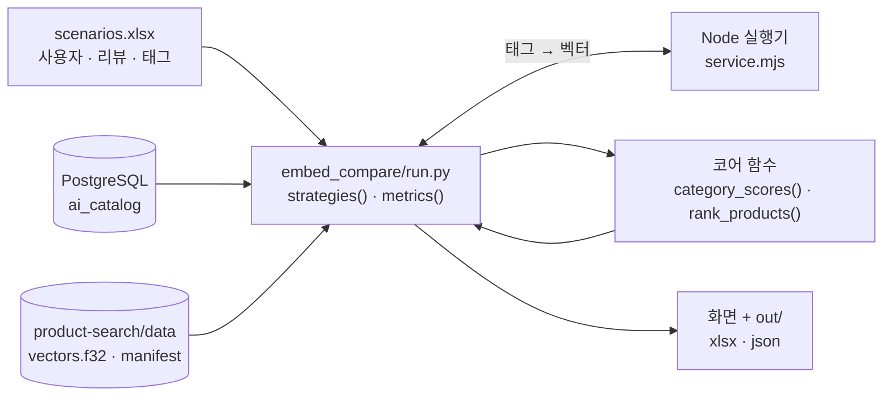
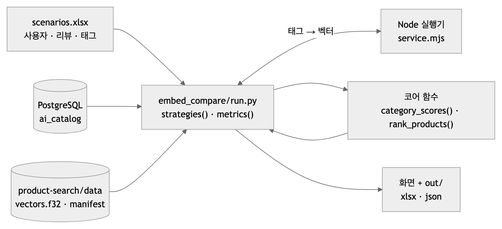

# 임베딩 비교 실험 — 방법 (2026-10-12)

| | |
|---|---|
| 목적 | [설계안](임베딩_추천_설계안_2026-10-12.md)의 세 방식(A · B · C)을 지금 점수식(S0)과 **같은 사람 · 같은 카탈로그**로 나란히 비교 |
| 도구 | `tools/embed_compare/run.py` — [README](../tools/embed_compare/README.md) |
| 입력 | 30개 콜백 검증 시나리오(`tools/scenario_callback30/scenarios.xlsx`)의 10명 + 새 **'태그'** 시트 |
| 모델 | 태그 추출 **`claude-opus-5-5`**(대화 중 수작업, 고정 프롬프트 없음) — 로컬 비교 `gemma4:12b` · `qwen3.5:9b`(`extract_tags.py`, Ollama) · 임베딩 **`jinaai/jina-embeddings-v5-text-nano-retrieval`**(q4f16 · 768차원, 로컬) |
| 비용 | 유료 API 없음. 서버 안 띄움. 로컬 추론만 |
| 결과 | [임베딩_비교_실험_결과](임베딩_비교_실험_결과_2026-10-12.md) |

---

## 1. 하네스

<!-- fig: 02-임베딩-비교-하네스 -->




30개 콜백 검증과 다른 점: 앱 · 7.7 을 타지 않고 **코어 함수만** 부른다(비교 대상이 순위뿐이라). 카탈로그는 같은 DB(`DbCatalogReader`), 편향 · 감점은 같은 `rank_products`.

## 2. 준비(한 번)

```bash
brew install node                                              # 10-12 설치: v26
cd product-search
npm ci --prefix embedding --ignore-scripts --no-audit --no-fund
uv sync --frozen --dev
uv run python tools/download_model.py                          # HF 고정 revision · 4파일 SHA-256 검사
uv run python tools/prepare_catalog.py --source ~/Downloads/gift-catalog-20260915-v1
cd embedding && node build.mjs                                 # 4,231개 상품 벡터 → data/vectors.f32 · manifest.json
```

모두 product-search 의 gitignore 대상(`data/` · `embedding/models/` · `node_modules/`) — 저장소 파일은 바뀌지 않는다. `prepare_catalog` 결과 카탈로그 해시 `dba5846d…` 는 Dylan 번들(`runtime-bundle.json`)과 같다.

## 3. 비교하는 네 방식

| 방식 | 30개를 고르는 법 |
|---|---|
| **S0** 지금 점수식 | `rank_products` — 인기(조회수 백분위 × 2) + 편향 + 비선호 감점, 앞 30 |
| **A** 임베딩만 | 태그마다 코사인 상위 50 → RRF 순서. 감점 모드면 비선호를 뒤로 |
| **B** 임베딩 + 점수 | A 의 후보 합집합을 2.0 × 유사도 백분위 + S0 점수로 정렬 |
| **C** B + MMR | 관련도(B 점수 0~1) λ 0.7 · 이미 고른 상품과의 유사도 0.3 |
| **D** 배제 후 검색(2차) | 비선호를 빼고 검색 · 축 가중(특징 ½) · MMR λ 0.7(백분위 관련도) · 한 소분류 최대 10 · 같은 브랜드 + 모델 코드 중복 제거 · 모자라면 비선호를 감점 순서로 채움 |

공통: 태그가 없으면 네 방식 모두 S0(대체). 후보가 30 미만이면 S0 순서로 채움. 두 모드(penalty · exclude) 모두.

## 4. 태그(`claude-opus-5-5` 가 대화 중 적음 — 검토 대상. 로컬 LLM 추출본은 시트의 '추출 모델' 열로 구분)

'태그' 시트 32개. 규칙: 별점 4~5 리뷰 상품과 취향 문장에서 4축(IP · 브랜드 · 카테고리 · 특징). 1~3점 · 비선호는 태그로 쓰지 않는다. U07(낮은 별점만) · U08(비선호만)은 태그 없음 → 대체. U06 은 취향 문장 "실용적인 선물" 하나뿐이라 **태그 하나로 순위가 얼마나 바뀌는지** 보는 사례가 된다.

| 번호 | 태그 |
|---|---|
| U01 | 카테고리 향수 · 핸드크림 · 남성 스킨케어 / 브랜드 조말론런던 · 비오템 / 특징 은은한 향 |
| U02 | 카테고리 헤드폰 · 노트북 거치대 / 브랜드 소니 / 특징 노이즈캔슬링 · 최신 전자기기 |
| U03 | 카테고리 출산 선물세트 · 아기 손수건 · 백색소음기 무드등 / 특징 신생아용 · 부드러운 소재 |
| U04 | IP 산리오 한교동 · 카카오프렌즈 춘식이 / 카테고리 다용도 테이블 · 보냉백 · 가습기 |
| U05 | 카테고리 차 선물세트 · 커피 · 케이크 / 브랜드 오설록 · 투썸플레이스 / 특징 달달한 디저트 |
| U06 | 특징 실용적인 선물 |
| U09 | 카테고리 향수 / 브랜드 조말론런던(뷰티는 비선호) |
| U10 | 카테고리 헤드폰 / 브랜드 소니 |

## 5. 지표

| 지표 | 뜻 | 좋은 방향 |
|---|---|---|
| 소분류 종수 | 30개에 섞인 소분류 수 | 많을수록 섞임(단, 취향과 무관하게 많으면 의미 없음) |
| 최다 소분류 | 가장 많이 나온 소분류와 개수 | 30 이면 독차지 |
| 편향 소분류 | 리뷰 편향이 양수인 소분류의 상품 수 | 0 이면 취향 무시, 30 이면 독차지 |
| 낮은 별점 소분류 | 편향이 음수인 소분류 상품 수 | 0 |
| 비선호 | 30개 중 비선호 대분류 상품 | 0 |
| S0 겹침 | 지금 30개와 같은 상품 수 | 참고 |
| 조회수 백분위 평균 | 30개의 인기 | 너무 낮으면 인기를 잃음 |
| 결정성 | 질의를 다시 임베딩해 다시 계산해도 30개가 같은가 | 같음 |
| 이름 중복 | 같은 브랜드 + 같은 모델 코드(`WH-1000XM6`) 상품이 둘 이상 | 0 |
| D 검사 | 30개 · 중복 없음 · 비선호 배제(비선호 아닌 상품이 30개 이상이면 0) · 이름 중복 0 · 한 소분류 최대 10 · 결정성 · U09 뷰티 0 · U08 30개 | 모두 통과(실패하면 종료 코드 1) |
| 시간 | 태그당 질의 임베딩 · 순위 계산 | 작을수록 |

정성 확인: '비교30' 시트에서 네 방식의 30개를 나란히, 'C_점수내역'에서 C 의 항목별 점수를 본다.

## 6. 한계

- 태그를 사람이 적었다 — 실제 LLM 추출 품질은 반영되지 않는다.
- 10명 시나리오 · 정답(실제 선호) 없음 — "섞임 · 취향 반영 · 비선호" 같은 구조 지표만 본다. 정확도(적중률)는 측정하지 않는다.
- 조회수는 BE 가 넣은 임의값 — 인기 항의 의미가 약하다.
- 매개변수(50 · 2.0 · 0.7)는 제안값 하나만 — 민감도는 결과 문서에 일부만.
