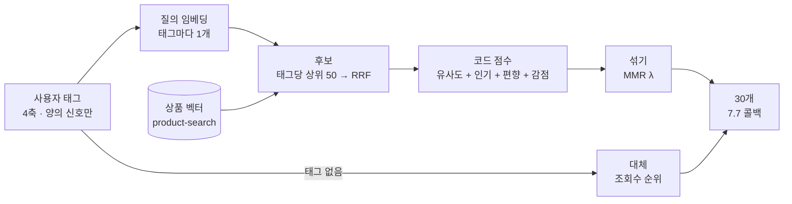
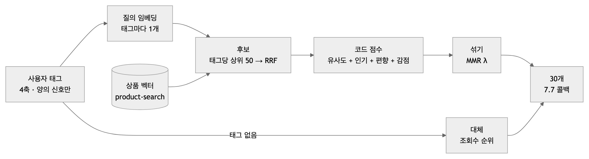

# 임베딩 후보 + 코드 점수 추천 — 설계안 (2026-10-12)

| | |
|---|---|
| 상태 | **후보안**(실험 중) — 코어(`pipeline.py`)는 바꾸지 않았다. 실험 방법은 [임베딩_비교_실험_방법](임베딩_비교_실험_방법_2026-10-12.md), 결과는 [임베딩_비교_실험_결과](임베딩_비교_실험_결과_2026-10-12.md) |
| 출발점 | [시나리오 검증 결과 10-12](시나리오_검증_결과_2026-10-12.md) — 5점 소분류가 30개를 독차지(양의 편향 6명 모두 30/30) |
| 사용자 제안(10-12) | 점수식 대신 상품마다 태그를 달아 임베딩, 사용자 정보에서 뽑은 태그도 임베딩 → 60개 찾고 중복 제거 → 30개 |
| 이 문서의 안 | 제안을 받아 **"임베딩은 후보 고르기, 코드 점수는 순서 정하기, MMR 은 섞기"** 로 나눈다 |
| **2차 갱신(10-12)** | 사용자 제안 "비선호를 완전히 뺀 상태에서 검색" → **D 안**(§6). 지금 추천안은 D |

---

## 1. 왜 원안(60 → 중복 제거 → 30)을 그대로 쓰지 않나

| 원안 그대로일 때 | 이유 | 이 안의 처리 |
|---|---|---|
| 독차지가 더 심해질 수 있다 | 5점 향수 태그로 찾은 가까운 60개는 거의 향수. 중복 제거는 같은 상품만 지우지 섞지는 않는다 | **MMR**(이미 고른 것과 비슷하면 깎음)로 섞는다 |
| 취향 평균의 함정 | 뷰티 + 디지털 태그를 벡터 하나로 평균하면 둘 사이의 아무것도 아닌 곳을 찾는다 | **태그마다 따로** 찾고 RRF 로 합친다 |
| '싫음'을 못 넣는다 | "뷰티 싫음"을 임베딩하면 뷰티 근처로 간다 | 비선호는 지금처럼 **코드 감점(−2.0) · 제외** |
| 낮은 별점도 끌어온다 | 1점 리뷰의 태그도 비슷한 상품을 부른다 | **4~5점과 취향 문장만** 태그로. 1~3점은 지금의 편향(음수) |
| 태그가 없으면 질의가 없다 | 콜드 스타트(리뷰·취향 없음) | **조회수 순위로 대체**(지금 v1 과 같음) |
| 인기를 잃는다 | 유사도만 보면 조회수 100 인 상품이 올라온다 | 순서를 정할 때 인기를 섞는다 |
| 60개가 모자랄 수 있다 | 재고 없음 · 비선호 · 중복을 빼면 30 아래 | 태그당 50개씩(태그 5개면 최대 250) · 모자라면 S0 순서로 채움 |

## 2. 구조

<!-- fig: 01-임베딩-추천-구조 -->




| 단계 | 규칙 | 지금 코드와의 관계 |
|---|---|---|
| ① 태그 | 4축(IP · 브랜드 · 카테고리 · 특징). 별점 4~5 리뷰와 취향 문장에서. 1~3점 · 비선호는 태그로 쓰지 않음 | 코어엔 태그 추출(LLM)이 아직 없음 — 실험은 손으로 적음 |
| ② 질의 | 태그 하나 = 질의 하나(`Query: ` 접두, Jina v5 nano 768차원) | 새로 생김 |
| ③ 후보 | 태그마다 코사인 상위 50 → RRF(상수 30)로 합집합 | 새로 생김(product-search 와 같은 RRF) |
| ④ 점수 | **2.0 × 유사도 백분위** + 인기(조회수 백분위 × 2) + `BIAS_WEIGHT` × 편향 + 비선호 감점 | 뒤 세 항은 `rank_products` 그대로. 유사도 항만 더함(최대 코사인을 후보 전체 백분위로 — 인기와 같은 크기) |
| ⑤ 섞기 | MMR: λ × 관련도(④ 점수 0~1) − (1 − λ) × 이미 고른 상품과의 최대 코사인 | 새로 생김. λ = 1 이면 ④와 같음 |
| ⑥ 대체 | 태그가 없으면 ③~⑤를 건너뛰고 지금 순위 | v1 과 같음 |

## 3. 원칙과 부딪히는지

| 원칙 | 판정 |
|---|---|
| 같은 입력 = 같은 결과(input_hash 중복 판정 · 재전송) | **지킴** — 모델 · 상품 벡터 · 매개변수를 고정하면 결정적. 실험에서 두 번 돌려 비교한다. 운영에선 `catalog_version_id` 옆에 모델 · 벡터 해시도 기록해야 함 |
| 위키 멀티스텝 "모델은 한 번만, 그 다음은 전부 코드" | **지킴** — LLM 은 ① 태그 추출 한 번. 임베딩은 생성 모델이 아니라 결정적 함수 |
| 10-11 폐기 "LLM 이 수식을 정함" | **부딪히지 않음** — 수식 · 가중치는 코드 상수 |
| 10-07 "편향은 순서만 조정하고 몫은 정하지 않음" | **바뀜(결정 필요)** — 후보를 태그로 거르는 것(③)과 MMR(⑤)은 순서 이상을 바꾼다. 몫을 숫자로 정하진 않지만 결과에 영향을 준다 |
| 결정 B(리뷰 · 취향 원문 저장 안 함) | **지킴** — 태그만 쓰고, 질의 벡터는 저장하지 않음 |

## 4. 의존성과 위험

| 항목 | 지금 상태 | 운영 반영 전 할 일 |
|---|---|---|
| 상품 벡터 | product-search(Dylan)가 만든 벡터(카탈로그 해시 `dba5846d…` = 09-22 번들과 같음). 메모리 스냅샷 | DB 카탈로그 버전과 함께 적재 · 새 상품 벡터 갱신 경로 |
| 질의 임베딩 | Node 실행기(onnxruntime-node) — 프로파일링은 Python 3.12, product-search 는 3.13 | 같은 프로세스에 넣을지, 검색기를 HTTP 로 부를지(`INTEGRATION.md`) |
| **모델 라이선스** | **CC BY-NC 4.0(비상업)** | 서비스 반영 전 팀 · 강사 확인. 안 되면 상업 허용 모델로 교체 후 재실험 |
| 태그 추출 | 없음 | LLM 추출 단계(10-11 유의사항 파일 기준) |
| 지연 | 질의 임베딩 태그당 수 ms~수십 ms(실험에서 측정) | 태그 수 상한 |
| ID | `source_product_id` → `backend_product_id` 로 연결됨 | 벡터 쪽도 BE 번호를 같이 기록 |

## 5. 결정할 것

1. 이 구조를 v2 후보로 채택할지(실험 결과를 보고)
2. 10-07 "몫을 정하지 않음" 원칙을 바꿀지 — 섞기 방법(MMR λ / 소분류 상한 K / 가중치)
3. 모델 라이선스 확인
4. 순서: 태그 추출(LLM) → 검색기 연결 → 이 단계

## 6. 2차 안 — D: 비선호를 빼고 검색 (10-12, 지금 추천안)

1차 실험에서 유사도 항이 비선호 감점을 상쇄하는 문제(U09 뷰티 7~8개)가 나왔다. 그래서 **검색 단계에서 비선호를 아예 뺀다(하드 패널티).**

**왜 하드 패널티인가 — U09 같은 충돌 때문이다.** 비선호 카테고리(뷰티)를 골랐는데 그 카테고리 상품(향수)에 5점을 준 경우, **비선호 카테고리 정보는 후보에서 제외하고 그 상품에서 뽑은 태그만 취향 신호로 쓴다.** 그러면 "뷰티는 싫다"는 선택은 지키면서 "좋은 향을 좋아한다"는 취향은 뷰티 밖(디퓨저 · 룸 스프레이 · 차량용 방향제)에서 살아난다. 감점으로는 둘을 동시에 못 한다 — 작으면 새고, 크면 후보가 비선호로 차서 결과가 엉뚱해진다.

```
1. 비선호 대분류 상품을 뺀 나머지에서 태그마다 검색(상위 50) → 축 가중 RRF   (특징 축 ½)
2. 점수 = 2.0 × 유사도 백분위(축 가중) + 인기 + 편향
3. MMR λ 0.7(관련도는 순위 백분위) + 같은 브랜드 · 같은 모델 코드는 하나만 + 한 소분류 최대 10   (10-12 사용자 결정)
4. 30개가 안 차면: 비선호 아닌 상품을 지금 순위로 → 그래도 모자라면 비선호를 감점 순서로(안전장치)
```

| 원칙 | 판정 |
|---|---|
| 10-11 "v1 제외 · v2 감점 · 제외 코드 남김" | **맞음** — 평소에는 제외로 동작하고, 감점은 30개를 못 채울 때 쓰는 안전장치. 감점의 원래 목적(악성 사용자가 비선호를 꽉 채워도 30개는 나감)은 그대로 지킨다. 지금 BE 상한(대분류 5개)을 꽉 채워도 4,231개 중 1,913개가 남는다 |
| 감점 크기 논쟁(−2.0 vs −4.0) | **없어짐** — 비선호가 점수 경쟁에 들어가지 않는다 |
| 10-07 "몫을 정하지 않음" | **바뀜(사용자 결정 10-12)** — 한 소분류 최대 10. 코어 반영 시 규칙표 갱신 |

결과는 [실험 결과 §8 · §9](임베딩_비교_실험_결과_2026-10-12.md). 인기 후보를 섞는 개선은 시험해 보니 취향만 흐려서 뺐다.
