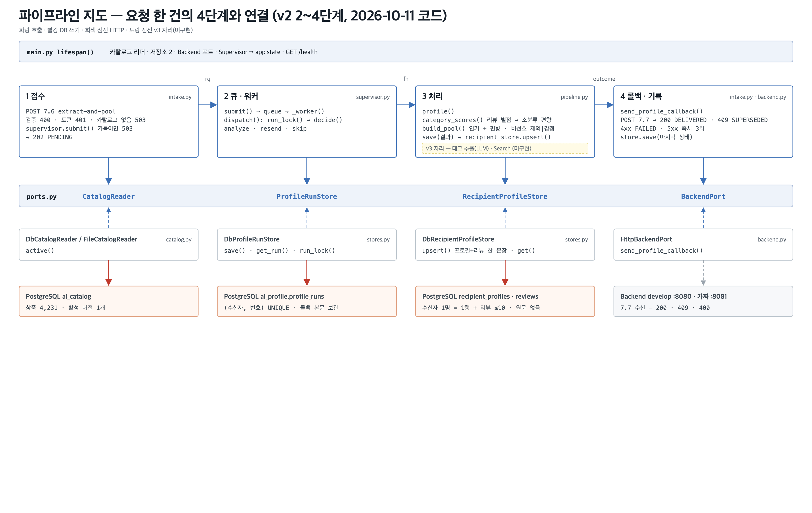

# 파이프라인 지도 — 2026-10-11 (v2 2~4단계: 별점 편향 · 비선호 스위치 · 리뷰 저장 — 원문 없이)

| | |
|---|---|
| 기준 코드 | 브랜치 `feat/v2-profiling-init` · 커밋 `8828571`(미푸시 3개 — `a1b6c68` 2단계 · `d96fb87` 3단계 · `8828571` 4단계). 바탕은 `integration/v2-profiling`(`0621cb1`) + `e56659f` · `d0c1b94`(푸시됨). **콜백 브랜치(`feat/profiling(AI-BE)_callback`, `624f91c` — 7.6 키 필수 1단계 · 입력 전부 비면 추천 0개 콜백)는 아직 합치지 않았다** |
| 범위 | **v2 리뷰 신호 중 별점 층** — 리뷰 별점 → 소분류 편향을 풀 순서에 반영, 리뷰·점수를 저장. 글·취향 → 태그(LLM)는 아직 없음(하네스 뒤). 프로파일링 전체는 여전히 **MVP2 백로그**(MVP QA 단계엔 AI 서버 미연결) |
| 동작 | 7.6 접수 → 202 → 워커: 잠금·중복 판정 → **리뷰 별점 → 소분류 편향**(`category_scores`) → 풀 = 인기 + 편향 (+ 비선호 감점 또는 제외) 30개 → 결과 저장 → **프로필 + 리뷰를 한 문장으로 저장** → 7.7. 10-11 로컬 실측: 리뷰 2개 요청 서버 처리 p50 2.1ms · 7.6 → DELIVERED p50 5.3ms(§3) |
| 저장소 | PostgreSQL — `ai_profile`(실행 기록 · 수신자 프로필 · **리뷰 자식 표 `recipient_reviews`**) · `ai_catalog`. alembic `0001`~**`0005`**. **리뷰 글·취향 문장 원문은 저장하지 않는다**(지문만, §4). 표 구조는 [DB_ERD.md](../DB_ERD.md) |
| 테스트 | `uv run pytest -q` → **255 passed · 1 failed · 2 skipped**(10-11 23시, DB 켠 채) · `ruff check src tests tools` 통과. 실패 1은 10-06과 같은 **시험 자료 충돌** — 로컬 DB의 콘솔 시험 행(수신자 1번 v7)에 `test_upsert_keeps_newer_version`이 v3을 넣어 무시됨(정상 동작). §5 3번 |
| 지난 판 | [2026-10-06.md](2026-10-06.md) |



## 0. 30초 요약

- **별점이 순서를 바꾼다.** 리뷰한 상품의 소분류마다 `점수 합 ÷ (n + 2)`(별점 − 3, 0점 두 개로 시작)로 편향을 만들고, 풀 점수 = **인기(조회수 ÷ 최대 × 2) + 1.0 × 편향**. 편향과 조회수를 같은 눈금으로 더해 5점 한 번 받은 소분류가 30개를 독차지하지 않는다. 1~2점 소분류도 빼지 않고 뒤로 민다. 리뷰가 없으면 v1과 같은 결과.
- **비선호는 스위치.** `PROFILING_DISLIKE_MODE` — `exclude`(기본, v1 그대로 뺌) / `penalty`(v2: 빼지 않고 −2.0에서 출발, 리뷰 편향은 그 위에 가산). 설계(DR-005 · 위키 데이터-컨텍스트)는 처음부터 감점이었고, 하드 제외는 다시 쓸 수 있게 남겼다. **BE V2 배포 때 `penalty`로 전환**.
- **리뷰는 원문 없이 저장.** 위키 "7.6 입력은 그 실행에서만 쓰고 저장하지 않습니다"에 맞춰 리뷰 글·취향 문장은 **지문(sha256)** 만 남긴다(10-07 원문 저장 결정 폐기). 리뷰 단위 캐시는 지문으로 판정.
- **프로필 + 리뷰 = 한 SQL 문장.** 잠금 커넥션(AUTOCOMMIT)에서도 원자적이고 왕복 1번. 실측 저장 1회 p50 0.4ms(트랜잭션 세 문장 0.9ms).

## 1. 단계별 — 지금 부르는 함수

| 단계 | 파일 | 함수 (하는 일) |
|---|---|---|
| 조립 (시작 1회) | `main.py` | `lifespan()` — 10-06과 같고, 시작 로그에 **`dislike_mode`** 추가 |
| ① 접수 | `intake.py` | `extract_and_pool()` — 10-06과 같음. `supervisor.submit(dispatch, …, dislike_mode=settings.DISLIKE_MODE)` |
| ② 큐·워커 | `supervisor.py` · `intake.py` | `dispatch()` → `run_lock()` → `decide()` → `run_and_callback(…, dislike_mode=)` / `resend_callback` / 없음 |
| ③ 처리 | `pipeline.py` | `profile()` — **0** `save(RUNNING)` → **1** `catalog.active()` → **2** **`category_scores(rq, products, catalog)`**(리뷰 상품의 소분류를 1)의 `products`에서 찾음 — `by_id` 안 씀, 같은 카탈로그 버전 · 카탈로그에 없는 리뷰는 개수 경고, 임시 번호면 원인 문구 · `score_categories()`) → **3** **`build_pool(…, dislike_mode=, scores=)`**(재고 `unavailable` 제외 · 점수 = 인기 + `BIAS_WEIGHT` × 편향 + (PENALTY 이고 비선호면 `DISLIKED_CATEGORY_SCORE`) · EXCLUDE 면 비선호 제외 · 30) → **4** `RESULT_READY` → **5** `save()` → **6** `recipient_store.upsert(from_outcome(…, category_scores=))`. 로그 `scores=N rule=v2-views+bias[+dislike-penalty]` |
| ④ 콜백·기록 | `intake.py` · `backend.py` | 10-06과 같음 |
| 포트 | `ports.py` | 서명 그대로. `RecipientProfileStore` 독스트링: upsert·get·delete 가 리뷰 자식 행 포함 |
| 구현(어댑터) | `stores.py` | `DbRecipientProfileStore.upsert()` — **CTE 한 문장 `_PROFILE_SAVE`**: `p` 프로필 upsert(버전 가드 · `RETURNING`) → `d` 이번에 안 온 상품의 리뷰 삭제 → `u` 리뷰 upsert(`unnest` 배열 넷). `get()` — `left join lateral json_agg` 로 리뷰(자리 순) · 점수 · 지문 복원. `delete()` — 리뷰 CASCADE |
| 자료형 | `types.py` | `CategoryScore`(`.bias`) · `score_categories()` · `review_hash()` · **`preference_hash()`** · `ReviewRecord`(상품 · 별점 · 지문 · 자리 0~9, **글 없음**) · `RecipientProfile.gift_preference_hash / category_scores / reviews` |
| 설정 | `settings.py` | **`DISLIKE_MODE`**(`exclude` 기본 · `penalty`, env `PROFILING_DISLIKE_MODE`) |
| 바깥 | | PostgreSQL `ai_chat`(alembic 0001~**0005**) · Backend(실물 `develop` :8080 / 가짜 :8081 — 가짜는 `giftPreference`·`reviews`를 늘 비워 보냄) |

## 2. 지난 판(10-06)에서 바뀐 것

| 무엇 | 왜 | 어디 |
|---|---|---|
| 리뷰 별점 → 소분류 편향(`score_categories` · `CategoryScore.bias`) | v2 리뷰 신호의 별점 층(10-07 규칙표: 편향 = 점수 합 ÷ (n+2)) | `types.py` · 커밋 `e56659f`·`d0c1b94` |
| 풀 점수 = 인기 + 편향 · `category_scores()` · 임시 번호 경고 | 2단계. 사전식이면 한 소분류가 독차지 · 요청 중 카탈로그 버전 변경 방지 · BE id-map 전엔 편향이 조용히 0 | `pipeline.py` · `a1b6c68` |
| 비선호 스위치 `DislikeMode` · `DISLIKE_MODE` · `DISLIKED_CATEGORY_SCORE = −2.0` | v1 제외 · v2 감점(악성 입력에도 풀이 비지 않음) · 하드 규칙은 남김 | `pipeline.py` · `settings.py` · `intake.py` · `d0c1b94`·`a1b6c68` |
| **0005** `recipient_reviews` · `gift_preference_hash` · `category_scores` — **원문 없음** | 리뷰 단위 행이 있어야 캐시·스냅샷 교체. 위키 "7.6 입력 저장 안 함" | `alembic/versions/0005_…` · `types.py` · `d96fb87` |
| 프로필 + 리뷰 CTE 한 문장 저장 · lateral 한 번 읽기 | 잠금 커넥션이 AUTOCOMMIT — 한 문장이어야 원자적, 09-28 "문장 하나 = 왕복 하나" 유지 | `stores.py` · `8828571` |
| `schemas.py` 설명 "제외 판정 키" → "비선호 판정 키(위키 7.6: 감점 대상)" | 위키·설계와 문구 일치 | `d0c1b94` |
| 시험 204 → **256**(단위 155 → 193, 통합 +12) | 편향 · 스위치 · 0005 · 한 문장 저장(잠금 커넥션 안 원자성 포함) | `tests/` |
| 문서 — `DB_ERD`(§2.3 새 절 · 그림) · `코드_안내서` · `DB_전환_설명` §6 · 이 지도 | — | `docs/` |

## 3. 돌려 보는 법과 확인 포인트

```bash
docker start profiling-ai-db
cd profiling && uv run alembic upgrade head                                 # head = 0005
uv run pytest -q                                                            # 255 passed · 1 failed(콘솔 자료) · 2 skipped
# 로컬 실측(10-11): 가짜 BE(:8081) + AI 두 벌 — 제외(:8010) · 감점(:8011)
uv run uvicorn tools.fake_backend.app:app --port 8081
PROFILING_BACKEND_BASE_URL=http://localhost:8081 PROFILING_SERVICE_TOKEN=dev-token PROFILING_DISLIKE_MODE=exclude uv run uvicorn profiling.main:app --port 8010
PROFILING_BACKEND_BASE_URL=http://localhost:8081 PROFILING_SERVICE_TOKEN=dev-token PROFILING_DISLIKE_MODE=penalty uv run uvicorn profiling.main:app --port 8011
# 가짜 BE 는 리뷰를 안 보내므로 7.6 을 직접 POST (Authorization: Bearer dev-token) — giftPreference · reviews 포함
```

**10-11 실측(로컬, 파일 카탈로그 111건, LLM 없음, 실패 0)** — 202 = POST → 202 · e2e = POST → `DELIVERED` · 서버 = `profile_runs` 생성 → 갱신

| 시험 | 결과 | 시간 |
|---|---|---|
| 리뷰 포함 1건 | 점수(802 5점 · 305 2점) · 지문 · 리뷰 2행 저장, **DB·서버 로그에 원문 없음**, 5점 소분류 상품 1위 | exclude 202 2.0 · e2e 7.4 · 서버 3.6ms / penalty 1.5 · 8.5 · 4.1ms |
| 같은 요청 재전송 | 재분석 없이 같은 30개, 콜백 시도 +1 | 202 1.0 · 완료 3.6ms |
| 순서 역전(v2 뒤 v1) | 프로필·리뷰 v2 그대로 | e2e 5.6ms |
| 한 건씩 30건 | 리뷰 없음: 202 p50 0.8 · e2e p50 5.4 / p95 5.7 · 서버 p50 2.0 / p95 2.2ms — 리뷰 2개: 0.8 · 5.3 / 5.6 · 2.1 / 2.4ms | 리뷰 저장 추가 ≈ 0.1ms |
| 40건 몰아 보내기(슬롯 1) | 전부 `DELIVERED` | 137.5ms · **291건/s** |
| 저장 1회(리뷰 10개 × 300회) | 두 방식 모두 정상 | **CTE · 잠금 커넥션 p50 0.4 / p95 0.6ms** · CTE · 풀 커넥션 0.7 / 0.9 · 트랜잭션 세 문장 0.9 / 1.1(최대 10.6)ms |

확인 포인트:
- `curl :8010/health` → `store.migration "0005"`. 로그 `profile … scores=N rule=v2-views+bias`(감점 모드면 `+dislike-penalty`).
- DB: `select recipient_user_id, category_scores, left(gift_preference_hash, 8) from ai_profile.recipient_profiles` · `select * from ai_profile.recipient_reviews order by 1, position` — 글 열이 없다.
- **감점 모드는 대부분 제외 모드와 같은 30개를 낸다.** −2.0이면 조회수 1위도 0점이라, 비선호가 아닌 재고 상품이 30개 이상이면 비선호 상품은 31위 밖(실측: 109개 중 109위). BE 비선호 상한 5개라 실제 카탈로그에선 거의 늘 같음 — 차이는 품절이 많거나 카탈로그가 작을 때(§4).
- 리뷰 상품 번호가 카탈로그와 맞아야 편향이 생긴다. DB 카탈로그가 임시 번호(BE id-map 전)면 경고 `리뷰 상품 0/m개만 카탈로그에 있음 — 카탈로그가 임시 번호 사용 중`.

## 4. 팀원이 알아야 할 결정·미결

| 항목 | 상태 | 내용 |
|---|---|---|
| 비선호 처리 | **결정 (10-11)** | v1 제외 · **v2 감점**. 하드 제외 코드는 스위치로 남김(`DISLIKE_MODE`). 직접 고른 비선호 = **−2.0에서 출발 + 리뷰 편향 가산**(상수엔 가중치 안 곱함). 설계(DR-005 · 위키 7.6 "감점 대상 판정 키" · 위키 선물-API "비선호는 경고 조건, 차단 아님")와 일치 |
| 감점 세기 | 미결 | −2.0이면 감점 모드가 사실상 제외와 같다(§3). 더 부드럽게 할지는 벤치로(`BIAS_WEIGHT` 1.0과 함께) |
| 원문 저장 | **결정 (10-11, B)** | 리뷰 글·취향 문장 원문은 저장 안 함 — 지문만. 10-07 결정 폐기(팀 폴더 폐기 등록부). 대가: 프롬프트 판 올린 전면 재추출은 BE 재전송 필요 |
| 저장 방식 | **결정 (10-11)** | 프로필 + 리뷰 CTE 한 문장(왕복 1 · 슬롯당 커넥션 1). 실측 p50 0.4ms |
| 순위 수식을 LLM이 정하기 | **폐기 (10-11)** | 재현성 · 사용자 글로 순위 조작 · 위키 "모델은 한 번만, 그 다음은 코드". LLM은 재료(태그)만, 상수는 오프라인 벤치 |
| 태그 축 | 결정 (10-11), 구현 전 | 카테고리(대분류 → 소분류 → product_kind) · IP(IP → 캐릭터) · 브랜드 · 특징 × 선호/비선호. 위키 3축(종류·특징·싫어함)과 다름 — 위키 검증 절의 묶음 방식 비교에 4축을 새 후보로 · Search/Chat 담당과 `axes` 모양 협의 필요 |
| 풀 0개 처리 | 미결(기존) | 설계 §1.4 "콜백 안 함" vs 코드 "빈 배열 콜백". 감점이면 비선호로 0개가 될 일은 사라짐 |
| 범위 · 재시도 · 배포 값 | 10-06 그대로 | [10-06 §4](2026-10-06.md) |

## 5. 다음 해야 할 일 (인수인계용)

| # | 무엇 | 왜 | 어디 (파일 · 함수) | 끝났다고 보는 기준 | 크기 |
|---|---|---|---|---|---|
| 1 | **v2 켜는 순서 한곳에** — BE V2 배포 때: ① `alembic upgrade head`(0005) ② 7.6 키 엄격화 2단계(`giftPreference`·`reviews` 키 필수 — 콜백 브랜치 `schemas.py`) ③ `PROFILING_DISLIKE_MODE=penalty` ④ BE id-map 적용 확인(임시 번호면 편향 0) | 셋이 같은 시점이고 하나라도 빠지면 조용히 v1처럼 돈다 | BE 세팅 가이드 다음 판 · 배포 compose | 순서표가 가이드에 있고 배포 env 에 값이 적힘 | 문서 |
| 2 | 브랜치 합치기 — `feat/v2-profiling-init`(푸시는 지시 시) → `integration/v2-profiling`, 콜백 브랜치(`624f91c`)와 합칠 때 `pipeline.py`·`schemas.py` 충돌 확인. 콜백 브랜치에 마이그레이션이 필요해지면 **0006** | 두 브랜치가 같은 파일을 고침 | git | 합친 뒤 `pytest -q` 초록 | 중 |
| 3 | 통합 시험 자료 격리 — `test_db_recipient_profiles::test_upsert_keeps_newer_version`의 수신자 1 → 9,000,000번대 | 콘솔·실물 시험 잔여 행과 충돌(10-06 §5 11번과 같은 원인) | `tests/integration/test_db_recipient_profiles.py` | 콘솔 자료가 있어도 256 passed | 10분 |
| 4 | 4축 태그 — 브랜드 정규화 사전(팀 폴더 브랜드 점검 엑셀 검토 뒤) · IP 사전을 상품 쪽에 붙이기 · `CategoryScore` → `(축, ID)` 일반화 · 대분류 번짐 | 결정만 있고 구현 전 | `types.py` · 카탈로그 적재 · `pipeline.build_pool` | 축별 편향이 점수에 들어가고 시험 통과 | 대 |
| 5 | LLM 태그 추출(하네스 뒤) — 4축 출력 · `product_attributes` · 판촉·증정·구매 경험 규칙 · 0006(`extraction`·`prompt_version`·`vocab_version`) | v2 글·취향 층 | `pipeline` v3 자리 · 검증기 · `alembic` 0006 | 하네스 기준 통과 | 대 |
| 6 | 상수 벤치 — `BIAS_WEIGHT` 1.0 · `DISLIKED_CATEGORY_SCORE` −2.0(감점이 사실상 제외 — 조정 여부) · 오프라인 LLM 채점 | 둘 다 임시값 | `pipeline.py` 상수 · 벤치 | 값 결정 기록 | 중 |
| 7 | 부하 하네스에 리뷰 옵션 · CTE 전후 비교 | 리뷰가 든 요청 처리량을 아직 하네스로 못 잼 | `tools/loadtest/run.py` | 리뷰 2·10개 시나리오 결과 표 | 소 |
| 8 | 문서 정정 — 10-07 규칙표("직접 선택 비선호 = 제외" → v1 제외 · v2 감점) · BE 필드표 다음 판 "비선호 제외" 그림 · FE·BE 시험 기대값("비선호 0건" → 감점 모드면 "뒤로") | 설계·코드와 문구 일치 | 팀 폴더 · `docs/` | 세 곳 정정 | 문서 |
| 9 | 풀 0개 처리 정리 — 설계 §1.4(콜백 안 함) vs 코드(빈 배열) | 기존 어긋남, 감점과 엮임 | `pipeline.profile` 3) · 상세설계서 | 한쪽으로 맞춤 | 소 |
| 10 | 10-06에서 이어지는 것 — `/ready` · 필드표 v1.1 · 통합 수정점 합의 · 배포 설정 · 못 보낸 결과 추적 등 | [10-06 §5](2026-10-06.md) | 10-06 §5 | 그대로 | — |

막히면 볼 것: [README.md](../../README.md) · [문서_목록.md](../문서_목록.md)(트리) · [코드_안내서.md](../코드_안내서.md) · [DB_ERD.md](../DB_ERD.md)(§2.3 리뷰 표 · 왜 한 문장인가) · [DB_전환_설명.md](../DB_전환_설명.md)

연락 없이 이어받을 때의 첫 30분: §3 명령으로 `pytest -q` → AI 두 벌을 띄워 리뷰 든 7.6 한 건 POST → DB 질의로 `category_scores`·리뷰 행 확인 → §5의 1·3번부터. 결정 근거(원문 저장 폐기 · LLM 수식 폐기)는 팀 폴더 `AI/폐기된_아이디어/`, 태그 축·비선호 감점은 팀 폴더 `일일작업물/첨부/2026-10-11_상품_필드_정리/태그추출_프롬프트_유의사항.md` 6·7절.
