# 프로파일링 코어 시험 결과 보고서 (2026-10-12)

| | |
|---|---|
| 대상 | AI 저장소 `profiling/` — 브랜치 `feat/v2-profiling-init` @ `c11f76c` + 작업 트리(인기 순위 백분위 · `rank_products` · **카탈로그 로드 뒤 `gc.freeze()`** · 시나리오 하네스 · 임베딩 비교 도구, **미커밋**) |
| 기간 | 10-11 ~ 10-12 |
| 범위 | 7.6 수신 → Supervisor 워커 → `pipeline.profile()`(별점 편향 · 30개 풀) → PostgreSQL 저장 → 7.7 콜백, 그리고 30개 고르는 방식의 대안(임베딩) 실험 |
| 쓴 모델 | **코어(S0) · 하네스 ①② : 모델 없음**(규칙 · 수식만) · **태그 추출: `claude-opus-5-5`**(Claude Opus 5.5 — 이 대화 안에서. 처음엔 고정 프롬프트 없이 적었고, 비교 기준은 로컬 모델과 같은 프롬프트로 다시 뽑은 `claude-opus-5-5-prompt`) → 비교용 **로컬 `gemma4:12b`(Q4_K_M, digest 4eb23ef187e2) · `qwen3.5:9b`(digest 6488c96fa5fa)**(Ollama · 고정 프롬프트 · temperature 0 · seed 42 · 생각 끔, §3.6) · **임베딩: `jinaai/jina-embeddings-v5-text-nano-retrieval`**(ONNX q4f16 · 768차원 · 로컬 · 글 → 벡터, 생성 모델 아님) · 유료 API 호출 없음 |
| 데이터 | 로컬 DB 카탈로그 `ai_catalog` 4,231개(BE 번호, 조회수 102~49,989 — BE 가 넣은 임의값) · 가상 수신자 10명(시나리오 엑셀) |
| 관련 문서 | [시나리오 검증 결과](시나리오_검증_결과_2026-10-12.md) · [임베딩 설계안](임베딩_추천_설계안_2026-10-12.md) · [실험 방법](임베딩_비교_실험_방법_2026-10-12.md) · [실험 결과](임베딩_비교_실험_결과_2026-10-12.md) · [파이프라인 지도 10-11](파이프라인_지도/2026-10-11.md) |

---

## 요약

1. **기능은 맞다.** 자동 시험 269개 중 266개 통과, 실패 1개는 로컬 DB 에 남겨 둔 콘솔 자료(수신자 1번) 때문이다. 앱 전체를 타는 30개 콜백 검증은 **검사 300/300 통과**다. 계약 · 재현성 · 비선호 · 점수 공식 독립 재계산 · 원문 미저장을 모두 확인했다.
2. **꼬리 지연을 찾아 고쳤다.** 서버 처리 p95 가 p90 의 2.5배로 튀는 꼬리가 있었고, 원인은 **세대 2 GC** 였다(GC 를 끈 대조로 확인). 카탈로그 로드 직후 `gc.freeze()` 를 코드에 반영해 앱만 띄운 7.6 200건 기준 서버 처리 **p95 25.9 → 9.9ms · p99 28.4 → 10.7ms**(GC 를 끈 대조 10.3ms 와 같은 수준). 202 응답 p95 1.2ms · 저장(CTE · 잠금 커넥션) p95 0.72ms. 이슈 [gc-tail-latency](issues/2026-10-12_0815_gc-tail-latency/).
3. **추천 품질에 구조적 결함이 있다.** 리뷰에 5점이 있는 6명 모두 그 소분류가 **30개를 전부 차지**한다. 원인은 정규화가 아니라 **선택성**이다 — 30개는 카탈로그의 0.7% 인데 편향 +0.67 은 순위 1/3 을 끌어올린다. 인기를 순위 백분위로 바꿔도 30개는 20건 모두 그대로였다.
4. **대안 실험(임베딩)으로 해결 방향을 찾았다**(태그 = `claude-opus-5-5`, 임베딩 = Jina v5 nano). 확정안 **D = 비선호를 빼고 검색(비선호 카테고리는 하드 제외, 좋게 평가한 상품의 태그만 취향 신호로) + 코드 점수 + MMR λ 0.7 + 한 소분류 최대 10 + 모델 코드 중복 제거**. 태그 있는 8명 모두 소분류 **8종 이상**(지금 1~2종), 인기 유지(조회수 백분위 0.74~0.94), 비선호 누수 0, D 검사 104/104, 결정성 20/20.
5. **같은 프롬프트로 비교해도 로컬 LLM 태그는 Claude 와 크게 다르다(§3.6).** 같은 SYSTEM · 입력으로 `claude-opus-5-5` 가 다시 뽑은 36개를 기준으로 `gemma4:12b` 는 18/36 일치 · 추천 30개 겹침 평균 18.3, `qwen3.5:9b` 는 7/36 · 9.7(U09 태그를 놓침). 차이는 주로 브랜드(8 · 2 · 0) · 카테고리(18 · 9 · 3) 축에서 난다. 사람당 추출 p95 는 gemma 21.3초 · qwen 9.1초(3회 × 10명). 태그 품질이 추천을 좌우한다 — 추출 모델 선택이 다음 결정이다.
6. **이상 결과 28건을 원인과 함께 정리했다(§4).** 원인 확인 19 · 추정 7 · 의도된 동작 2. 새로 찾은 것: GC 꼬리 지연(실측으로 확인) · 검증기 다중 근거 결함(수정).
7. **남은 위험:** 모호한 태그 하나가 순위를 뒤집는다(U06) · 질의 임베딩이 태그당 p95 33ms(지금 서버 처리의 3배) · 모델 라이선스 CC BY-NC 4.0 · 정답(실제 선호) 없이 구조 지표만 봤다.

---

## 1. 시험 체계

| 층 | 무엇 | 도구 | 이 보고서의 결과 |
|---|---|---|---|
| 단위 | 함수 단위 규칙(점수 · 풀 · 계약 · 설정 · 디바운스 · 재시도) | `tests/unit` 204개 | §2.1 |
| 통합 | 실제 PostgreSQL · 앱 전체 TestClient | `tests/integration` 65개 | §2.1 |
| 하네스 ① 로컬 실측 | 서버를 띄워 HTTP 로 7.6, 두 비선호 모드 동시, 저장 방식 비교 | `e2e_v2.py`(10-11) | §2.3 |
| 하네스 ② 30개 콜백 검증 | 가상 수신자 10명 × 2모드 → 앱 전체 → **진짜 `HttpBackendPort` 의 7.7 요청** 기록 · 자동 검사 13 + 시나리오 기대 23 | `tools/scenario_callback30` | §2.2 · §2.3 · §2.4 |
| 실험 — 임베딩 비교 | 같은 사람 · 카탈로그로 S0(지금) vs A · B · C · D | `tools/embed_compare` | §3 |

하네스 구조 그림: [하네스 ①](assets/scenario/01-로컬실측-하네스.png) · [하네스 ②](assets/scenario/02-콜백30-하네스.png) · [임베딩 비교](assets/embed/02-임베딩-비교-하네스.png) · [D 구조](assets/embed/01-임베딩-추천-구조.png).

## 2. 지금 코어(S0)의 결과

### 2.1 자동 시험

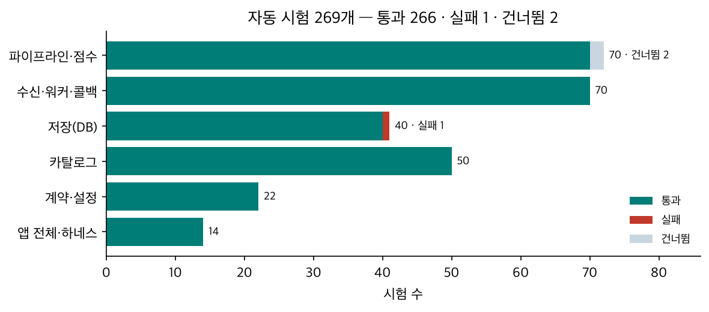

| 결과 | 내용 |
|---|---|
| 통과 266 | 단위 202 · 통합 64 |
| 건너뜀 2 | `test_recipient_profile` — 선택 의존 경로 |
| **실패 1** | `test_db_recipient_profiles::test_upsert_keeps_newer_version` — 기대 `(3, ['휴대용'])` 실제 `(7, [])`. 시험이 수신자 1번을 쓰는데 로컬 DB 에 콘솔 실물 자료(수신자 1번 v7)가 남아 있어서다. **코드 결함 아님** — 콘솔 자료를 유지하기로 했다(10-11). 시험 자료 격리(전용 번호대)로 고칠 일 |

### 2.2 기능 정확성 — 30개 콜백 검증(하네스 ②)

20건(10명 × 제외/감점) · **검사 300/300 통과**. 자동 검사 13개는 다음을 매 실행 확인한다.

| 검사 | 확인 방법 |
|---|---|
| 접수 · 콜백 | 202 · 7.7 정확히 1회 · 경로 · Bearer 토큰 |
| 계약 | 7.7 본문을 `ProfileCallbackRequest`(모르는 필드 금지)로 다시 검증 |
| 30개 | 개수 = min(30, 후보) · 중복 없음 · 카탈로그에 있고 품절 아님 |
| 재현성 | 콜백 30 = 실행 기록 30 = 같은 입력으로 다시 계산한 순위 앞 30 |
| 비선호 | 제외 모드 0개 · 감점 모드는 비선호 아닌 상품 뒤에만 |
| **독립 재계산** | 소분류 점수(별점 − 3 의 합 ÷ (n + 2))와 총점(인기 백분위 × 2 + 편향 + 감점)을 코드와 **다른 방법**으로 다시 계산해 오차 < 1e-9 |
| 저장 | 저장된 점수 = 코드 점수 · 리뷰 행(중복 제거 · 자리 · 지문) · **리뷰 글 · 취향 문장 원문이 DB 어디에도 없음** · 실행 기록 DELIVERED |

시나리오 기대 23개(5점 소분류가 상위 10 안 · 1~2점 소분류가 30 밖 · 비선호 대분류 0 · 콜드 스타트는 조회수순 · 이름만 맞는 비선호도 제외 등)도 모두 통과했다. 엣지 입력(같은 상품 두 번 · 없는 상품 · 3점 · 틀린 비선호 ID)은 코어 규칙대로 처리됐다.

### 2.3 성능 — 백분위(p75 · p90 · p95 · p99)

꼬리를 보려고 표본을 늘려 다시 쟀다(`tools/bench/percentiles.py`, 원자료 `docs/assets/report/percentiles.json`). 앱만 띄운 측정은 하네스 계산 없이 7.6 을 순서대로 200건 보내고(운영에 가까움), 조건마다 새 프로세스로 돌렸다. **반영 전**은 지금 코드에서 카탈로그 로드 뒤 `gc.unfreeze()` 로 freeze 를 풀어 재현했다.

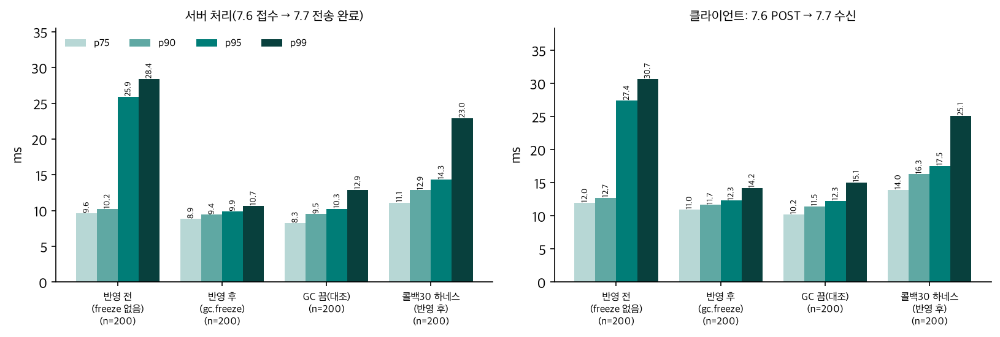

| 측정(n = 200) | p75 | p90 | **p95** | p99 | 최대 |
|---|---|---|---|---|---|
| 서버 처리 · **반영 전**(freeze 없음) | 9.6 | 10.2 | **25.9** | 28.4 | 29.6 |
| 서버 처리 · **반영 후**(`gc.freeze()`, 지금 코드) | 8.9 | 9.4 | **9.9** | 10.7 | 11.2 |
| 서버 처리 · GC 끔(대조) | 8.3 | 9.5 | **10.3** | 12.9 | 16.9 |
| 7.6 POST → 7.7 수신 · 반영 전 | 12.0 | 12.7 | **27.4** | 30.7 | 31.0 |
| 7.6 POST → 7.7 수신 · 반영 후 | 11.0 | 11.7 | **12.3** | 14.2 | 16.2 |
| 7.6 POST → 202 · 반영 후 | 1.0 | 1.1 | **1.2** | 1.9 | 8.0 |
| 30개 콜백 하네스 10회 · 서버 처리 · 반영 후 | 11.1 | 12.9 | **14.3** | 23.0 | 119.7 |
| 30개 콜백 하네스 10회 · 7.6 → 7.7 수신 · 반영 후 | 14.0 | 16.3 | **17.5** | 25.1 | 124.6 |

단위 ms. 세대 2 GC 수집은 반영 전 · 후 모두 13회(끔 0) — **횟수는 같고 한 번이 가벼워진 것**이다(상주 카탈로그를 더 훑지 않음). 같은 하네스가 반영 전엔 p95 76.6ms 였다(§4 P1 · P2). 반영 후 하네스 최대 119.7ms 1건은 §4 P3.

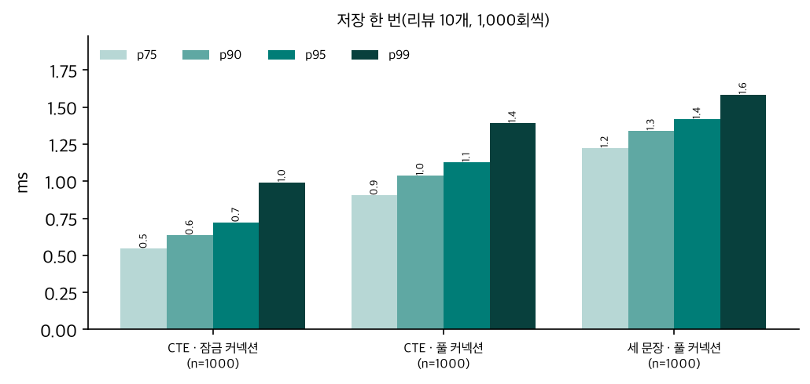

| 저장 한 번(리뷰 10개, 1,000회) | p75 | p90 | **p95** | p99 | 최대 |
|---|---|---|---|---|---|
| CTE 한 문장 · 잠금 커넥션(채택, 운영 경로) | 0.55 | 0.64 | **0.72** | 0.99 | 12.3 |
| CTE 한 문장 · 풀 커넥션 | 0.91 | 1.04 | **1.13** | 1.39 | 6.9 |
| 트랜잭션 세 문장 · 풀 커넥션(가이드 원안) | 1.22 | 1.34 | **1.42** | 1.58 | 2.2 |

채택한 CTE · 잠금 커넥션이 p99 까지 모든 백분위에서 가장 빠르다(왕복 1 · 커넥션 재사용). 같은 측정을 오전에 했을 때는 p95 1.28ms 로 전체가 1.8배 느렸다 — 그때는 로컬 LLM 이 메모리에 올라 있었다(§4 P6). 10-11 하네스 ①(서버 실기동, 파일 카탈로그 111개)의 몰아 보내기 40건 291건/s 는 그대로 유효하다 — 백분위 원자료는 남아 있지 않아 이 표에 넣지 않았다.

### 2.4 추천 품질 — 독차지

| 관찰 | 값 |
|---|---|
| 리뷰에 양의 편향이 있는 6명(U01 · U02 · U03 · U04 · U05 · U10) | **30개 중 편향 소분류 상품 30개**, 소분류 1~2종 |
| 인기 정규화 변경(조회수 ÷ 최대 → 순위 백분위) | 20건 모두 30개 **겹침 30/30** — 결과 불변 |

**원인(선택성):** 인기는 0~2 에 고르게 퍼지는데 편향 +0.67 은 순위 1/3 크기다. 편향 소분류 상품은 조회수 상위 1/3 만 돼도 편향 없는 1위를 넘는다. 소분류 하나에 평균 74개라 상위 1/3 만 약 25개다. 처음엔 "조회수가 45,000~50,000 에 몰렸다"고 진단했으나 틀렸다(소분류별 상위 3개만 본 표본의 일반화) — 실제 분포는 고르다(하위 10% 5,236 · 상위 10% 45,181).

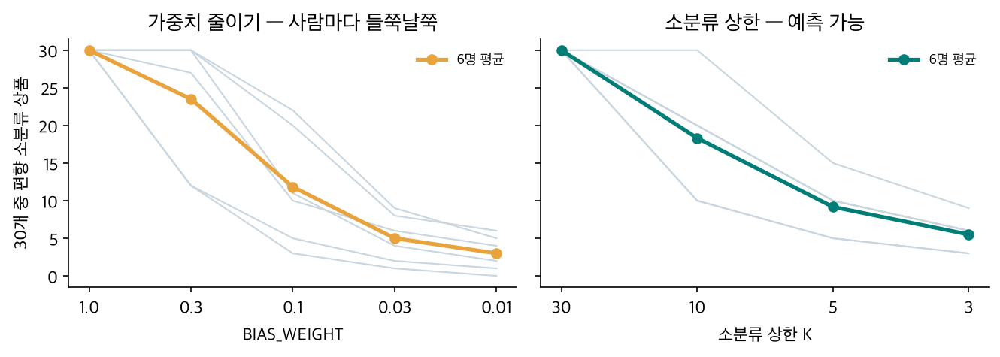

코드는 바꾸지 않고 `rank_products` 로 두 처방을 시뮬레이션했다. **가중치를 줄이면 사람마다 효과가 들쭉날쭉하다**(W 0.3 에서 U01 은 12개, U02 · U04 · U10 은 여전히 30). **소분류 상한은 예측 가능하다**(편향 상품 ≤ K × 편향 소분류 수).

## 3. 대안 실험 — 임베딩으로 30개 고르기

사용자 제안(점수식 대신 태그 임베딩으로 후보 → 중복 제거 → 30)을 받아 세 차례 실험했다. 입력은 시나리오 10명 + 손으로 적은 4축 태그 32개(결과 엑셀 '입력_사용자' · '입력_리뷰' · '태그' 시트).

| 방식 | 30개를 고르는 법 |
|---|---|
| S0 | 지금 코어(인기 + 편향 + 감점) |
| A | 태그 임베딩 상위만(RRF) |
| B | A 후보 + 코드 점수(유사도 + 인기 + 편향 + 감점) |
| C | B + MMR λ 0.7 |
| **D(확정)** | **비선호를 빼고 검색**(비선호 카테고리 하드 제외 — §3.2) · 축 가중(특징 ½) · 코드 점수 · MMR λ 0.7(순위 백분위 관련도) · **한 소분류 최대 10** · 같은 브랜드 + 모델 코드 중복 제거 · 모자라면 비선호를 감점 순서로 |

### 3.1 섞임

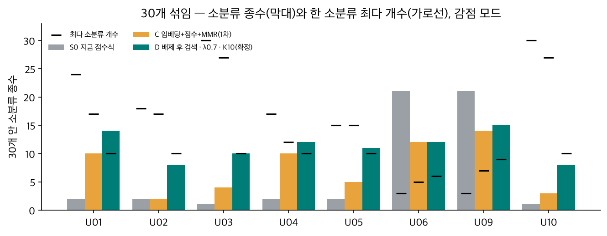

| 사람 | S0 | C(1차) | **D(확정)** |
|---|---|---|---|
| U01 뷰티 | 2종 / 최다 24 | 10 / 17 | **14 / 10** |
| U02 디지털 | 2 / 18 | 2 / 17 | **8 / 10** |
| U03 신생아 | 1 / 30 | 4 / 27 | **10 / 10** |
| U04 캐릭터 | 2 / 17 | 10 / 12 | **12 / 10** |
| U05 홈카페 | 2 / 15 | 5 / 15 | **11 / 10** |
| U10 엣지 | 1 / 30 | 3 / 27 | **8 / 10** |

U06 · U09 의 S0 21종은 섞였다기보다 편향이 없어 조회수순이라서다(U09 는 향수가 비선호 뷰티라 감점됨).

**질적 관찰:** U04 는 임베딩이 산리오 한교동 · 헬로키티 테이블, 춘식이 보냉백 · 칫솔 살균기, 쿠로미 우양산 같은 **IP(캐릭터) 상품을 소분류를 가로질러** 찾았다. 소분류 편향만 보는 S0 는 이 취향을 표현할 수 없다.

### 3.2 비선호 누수

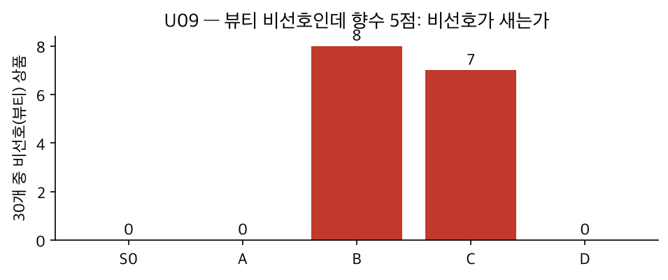

U09 는 뷰티를 비선호로 골랐지만 향수에 5점을 줬다. B · C 는 유사도(+2.0) + 편향(+1.0)이 감점(−2.0)을 넘어 **뷰티 7~8개가 들어왔다.**

> **D 에 비선호 하드 패널티(검색 전 제외)를 넣은 이유가 바로 이 경우다.** 사용자가 고른 비선호 카테고리와 그 카테고리의 상품에 남긴 높은 별점이 충돌할 때, **비선호 카테고리 정보는 후보에서 완전히 빼고, 좋게 평가한 그 상품에서 뽑은 태그만 취향 신호로 쓰기 위해서**다.
>
> - U09 에서 빠지는 것: 뷰티 대분류 전체(향수 소분류 포함) — "뷰티는 받고 싶지 않다"는 명시적 선택을 그대로 지킨다.
> - U09 에서 남는 것: 5점 상품의 태그(`카테고리:향수` · `브랜드:조말론런던`)가 담은 **"좋은 향"이라는 취향** — 이 태그로 뷰티 밖을 검색한다.
> - 결과: 30개 중 비선호 **0개**, 대신 디퓨저 · 룸 스프레이 · 차량용 방향제 같은 **생활 향 제품**(홈프래그런스 9). "향은 좋아하지만 뷰티 제품은 싫다"를 둘 다 만족한다.
> - 감점(소프트 패널티)으로는 이 둘을 동시에 못 한다: 감점이 작으면 비선호가 새고(B · C 7~8개), 크게 하면(−4.0) 누수는 막지만 비선호 상품이 검색 후보를 차지해 그 밖의 결과가 엉뚱해진다(A: 양말 · 실내복 · 캠핑랜턴 — 태그와 가까운 상품 50개가 대부분 비선호라 뒤로 밀린 뒤 남은 게 없음).

감점은 지우지 않고 **30개를 못 채울 때만 쓰는 안전장치**로 남긴다 — 비선호를 상한(대분류 5개)까지 고른 악성 입력에도 30개가 나간다(10-11 감점 결정의 목적 유지). 단위 시험: 비선호 아닌 상품이 10개뿐이면 나머지 20개를 감점 순서로 채움.

### 3.3 섞임 vs 인기

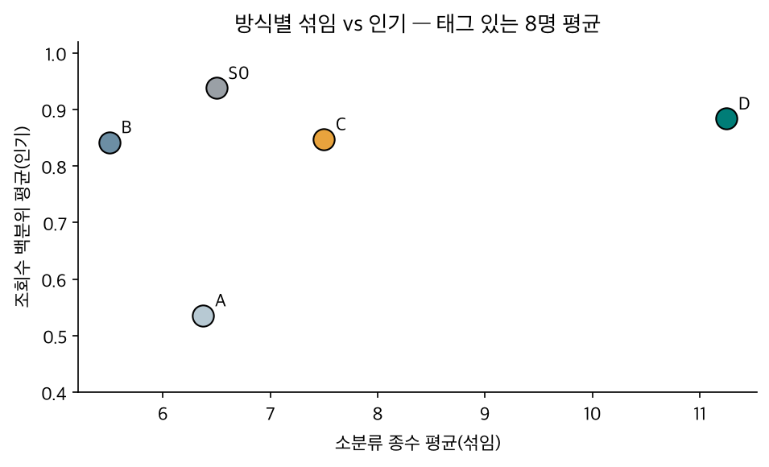

A(임베딩만)는 인기를 잃는다(조회수 백분위 0.53). D 는 섞임을 가장 많이 얻으면서 인기를 S0 가까이 유지한다.

### 3.4 매개변수 결정

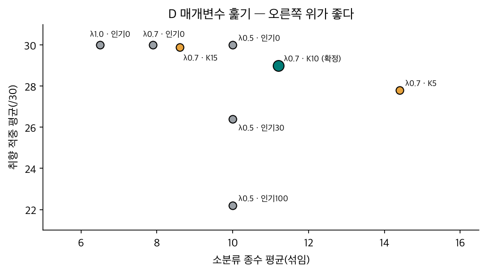

"취향 적중" = 30개 중 태그 검색 상위 50 안에 들었거나 리뷰 편향이 양수인 상품 수.

| 결정 | 근거 |
|---|---|
| 인기 후보를 섞지 않는다 | 인기 상위 100 을 후보에 넣으면 적중 30 → 22. S0 앞 100 은 이미 편향 소분류라 섞임도 안 늘었다 |
| **λ 0.7**(사용자 결정) | 0.5 는 카메라 · 키링 같은 느슨한 상품이 섞였다 |
| **K = 10**(사용자 결정 · 값은 훑기로) | K 5 는 U10 적중 12, K 15 는 5점 소분류가 둘인 사람(U02 · U05)에게 15 + 15 로 효과 없음. K 10 은 모두 8종 이상 · 적중 평균 29 |
| 중복 = 같은 브랜드 + 모델 코드 | 코사인으론 못 가른다 — SONY WH-1000XM6 색상끼리 0.91~0.96, 다른 모델(WF 이어폰)과도 0.94 |

### 3.5 비용

| 단계 | 시간 |
|---|---|
| 질의 임베딩(로컬 ONNX, 태그 1개, n 560) | p75 27.5 · p90 29.5 · **p95 32.8** · p99 35.8ms — 한 사람(5~6 태그, 순서대로) 약 0.2초 |
| D 순위 계산(사람 1명, n 50, freeze 반영 후) | p75 21.2 · p90 23.6 · **p95 23.8** · p99 39.7ms — 반영 전 p95 42.5ms(같은 GC 원인) |
| 상품 벡터 생성(1회) | 4,231개 약 11분(병렬 4) |

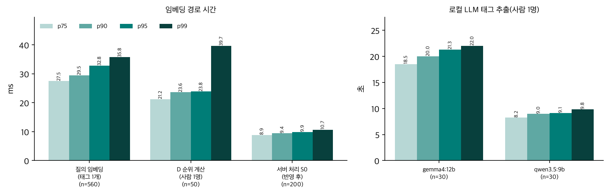

7.6 은 비동기라 BE 응답(202)에는 영향이 없지만 콜백까지 시간은 수 배 늘어난다. 태그 배치 임베딩 · 질의 캐시로 줄일 수 있다.

### 3.6 태그 추출 모델 비교 — 같은 프롬프트로 Claude vs 로컬 LLM

**모두 같은 입력 · 같은 프롬프트다.** 입력은 취향 문장 · 리뷰 별점 · 글 · 리뷰 상품의 카탈로그 정보(페르소나는 넣지 않음), 프롬프트는 `tools/embed_compare/extract_tags.py` 의 SYSTEM(해시 `2fc950d4` — 팀 '태그추출_프롬프트_유의사항' 1 · 2 · 3 · 6절 + "별점 4~5점과 취향 문장만 근거") + 사람별 입력 10개. 출력은 같은 JSON 스키마이고 **같은 검증기**(근거가 1~3점 리뷰뿐이거나 판촉 단어면 버림)를 거친다.

| 추출 모델 | 어떻게 돌렸나 |
|---|---|
| **`claude-opus-5-5-prompt`(기준)** | 로컬 모델과 똑같은 SYSTEM · 입력을 Claude Opus 5.5 가 이 대화 안에서 받아 답함(원출력 `out/claude_prompt_responses.json` → `extract_tags.py --from-json`). API 호출이 아니라 시간은 없음. **이 대화에서 시나리오 설명 · 이전 태그를 이미 봤으므로 완전한 블라인드는 아님** |
| `claude-opus-5-5`(참고) | 처음 기준 — 고정 프롬프트 없이 대화 중에 적음 |
| `gemma4:12b` · `qwen3.5:9b` | Ollama · temperature 0 · seed 42 · 생각 끔 · JSON 스키마 강제 · 3회 반복(태그 매번 동일) |

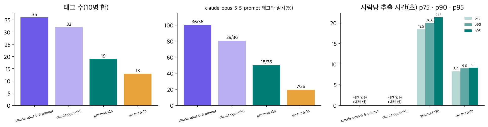

| 추출 모델 | 태그(사람) | 축 분포 | 기준과 일치(정확 / 근접 ≥ 0.80) | 사람당 시간 p75 · p90 · p95 | D 30개 겹침 평균 | D 검사 |
|---|---|---|---|---|---|---|
| **`claude-opus-5-5-prompt`(기준)** | 36(8) | 카테고리 18 · 브랜드 8 · 특징 7 · IP 3 | — | 없음(대화 안) | 30 | 통과 |
| `claude-opus-5-5`(대화 수작업) | 32(8) | 카테고리 16 · 브랜드 7 · 특징 7 · IP 2 | 29/36 · 29/36 | 없음 | 22.9 | 통과 |
| `gemma4:12b` | 19(7) | 카테고리 9 · 특징 5 · IP 3 · 브랜드 2 | 18/36 · 19/36 | 18.5 · 20.0 · 21.3s | **18.3** | 통과 |
| `qwen3.5:9b` | 13(7) | 특징 8 · 카테고리 3 · IP 2 · 브랜드 0 | 7/36 · 8/36 | 8.2 · 9.0 · 9.1s | **9.7** | 통과 |

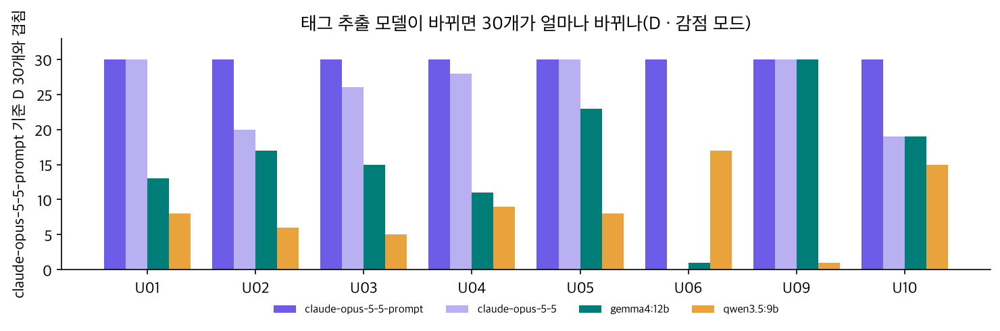

| 사람 | claude-opus-5-5-prompt(기준) | gemma4:12b | qwen3.5:9b |
|---|---|---|---|
| U01 | 향수 · 핸드크림 · 은은한 향 · 조말론런던 · 남성 스킨케어 · 비오템 | 은은한 향 · 향수 → D 5종으로 좁아짐(기준 14종) | 은은한 향 · 산뜻함 → 품목 태그 없음 |
| U02 | 헤드폰 · 노이즈캔슬링 · 소니 · 노트북 거치대 · 알리오 · 전자기기 | 노이즈캔슬링 · 헤드폰 · 노트북 거치대(브랜드 없음) | 노이즈캔슬링 · 튼튼함 |
| U03 | 출산선물세트 · 아기 손수건 · 백색소음기 무드등 · 유아용품 · 부드러운 소재 · 수면 도움 | 출산선물세트 · 부드러운 소재 · 백색소음 | 부드러운 소재 · 잠자기 좋은 기능 |
| U04 | 춘식이 · 한교동 · 산리오 · 다용도 테이블 · 보냉백 · 가습기 | 춘식이 · 한교동 · 산리오(IP 3개는 기준과 **완전히 같음**, 품목 없음) | 춘식이 · 한교동 |
| U05 | 커피 · 달달한 디저트 · 차 선물세트 · 케이크 · 오설록 · 투썸플레이스 | 같은 품목 · 특징 4개(브랜드 없음) → 겹침 23 | 디저트 · 커피 · 차 |
| U06 | 실용성 | **없음** → 조회수 순위 | 실용적 |
| U09 | 향수 · 조말론런던 | 같음 → 겹침 30 | **없음**(놓침) |
| U10 | 헤드폰 · 소니 · 노이즈캔슬링 | 헤드폰 · 소니 → 겹침 19 | 노이즈캔슬링 |

**읽는 법**

- **같은 프롬프트에서 차이는 축에서 난다.** IP 는 세 모델이 거의 같다(Claude 3 · gemma 3 · qwen 2). 갈리는 건 **브랜드(8 · 2 · 0)와 카테고리(18 · 9 · 3)**다. 로컬 모델은 리뷰 상품의 브랜드 · 종류 정보를 입력으로 받고도 태그로 잘 옮기지 않는다 → 추천 30개가 기준과 gemma 18.3개 · qwen 9.7개 겹친다.
- **gemma4:12b 는 "적게 내되 틀리지 않는다".** 낸 19개 중 18개가 기준과 일치(정밀도 높음, 재현율 50%). U06 모호 문장엔 태그를 안 내서 모호 태그 문제를 피했다.
- **qwen3.5:9b 는 특징 위주에 범용 특징이 많고 U09 를 놓쳤다**(재현율 19%).
- **같은 모델도 프롬프트가 바뀌면 달라진다.** Claude 대화 수작업과 같은 프롬프트 판은 태그 29/36 일치, 추천 30개 겹침 평균 22.9. 특히 **U06 은 "실용적인 선물" → "실용성"으로 글자만 바뀌었는데 30개가 하나도 안 겹쳤다**(§4 L6) — 모호 태그는 동의어 수준의 차이에도 결과를 통째로 바꾼다.
- **결정성:** 로컬 두 모델은 같은 설정으로 세 번 돌려 태그가 완전히 같았다.
- **시간:** 로컬 LLM 은 사람당 p95 9~21초 — 지금 서버 처리(p95 약 10ms)의 1,000배 단위다. 7.6 은 비동기라 BE 응답엔 영향이 없지만 워커 슬롯을 그만큼 오래 잡는다(10-07 결정: 리뷰는 `review_hash` 단위로 한 번만 추출).
- **남은 비대칭:** Claude 기준은 대화 안에서 답해 시나리오를 미리 알고 있었다. 완전한 블라인드 비교는 같은 프롬프트로 Claude API 를 새로 호출해야 한다(유료, 승인 필요).
- 검증기 결함 1건을 찾아 고쳤다(§4 L1).

## 4. 이상 결과와 원인

시험마다 기대와 다르거나 튀는 결과를 모았다. **원인 상태:** ✅ 확인(실측 · 대조 실험으로 재현) · 🔶 추정(근거는 있으나 대조 실험 전) · ⚪ 의도된 동작.

### 4.1 자동 시험 · 기능

| # | 이상 결과 | 원인 | 상태 |
|---|---|---|---|
| T1 | `test_upsert_keeps_newer_version` 실패 — 기대 `(3, ['휴대용'])` 실제 `(7, [])` | 시험이 수신자 1번을 쓰는데 로컬 DB 에 콘솔 실물 자료(1번 · v7)가 남아 있어 "더 새 판 유지" 규칙대로 v3 가 거부됨. 코드는 맞게 동작 | ✅ |
| T2 | 건너뜀 2 | v3 기능(`merge_explicit_dislikes` · Search 인자) 구현 전이라 일부러 skip | ⚪ |
| F1 | 5점 소분류가 30개 독차지(6명 모두 30/30) | 선택성 — 30개 = 카탈로그 0.7%, 편향 +0.67 = 순위 1/3. 가중치 · 상한 시뮬레이션으로 재현(§2.4) | ✅ |
| F2 | 인기를 순위 백분위로 바꿔도 30개 불변(20건 30/30) | 조회수가 102~49,989 에 고르게 퍼져 "÷ 최대"와 백분위가 거의 같은 값 | ✅ |
| F3 | 경고 "리뷰 상품 2/3개만 카탈로그에 있음" | U10 시나리오의 없는 상품(999999) — 엣지 입력을 일부러 넣음 | ⚪ |
| A1 | (분석 오류) 처음 진단 "조회수가 45,000~50,000 에 몰림" | 소분류마다 상위 3개만 본 표본을 전체로 일반화. 전체 분포를 다시 세어 정정 | ✅ |

### 4.2 성능

| # | 이상 결과 | 원인 | 상태 |
|---|---|---|---|
| P1 | 서버 처리 p90 → p95 가 계단처럼 뜀(앱만 10.2 → 25.9ms, 하네스 17.8 → 76.6ms) · 느린 요청이 사람 · 순서와 무관하게 5~6% | **세대 2 GC.** 요청마다 `ScoredProduct` 4,231개를 만들어 할당 문턱을 넘고, 그때마다 프로세스 내내 사는 카탈로그 `ProductRecord` 4,231개까지 훑는다. GC 끔 → p95 10.3ms · 느린 요청 0 으로 재현. **카탈로그 로드 뒤 `gc.freeze()` 를 반영해 p95 9.9ms**(`catalog._freeze_long_lived`, 시험 `test_catalog_is_frozen_out_of_gc_and_reload_does_not_pile_up`). [이슈](issues/2026-10-12_0815_gc-tail-latency/) | ✅(해결 · 미커밋) |
| P2 | 반영 전 하네스 꼬리(p95 77ms)가 앱만(26ms)보다 훨씬 컸고, 반영 전 실험에서 하네스에 freeze 를 걸어도 효과가 없었음 | 하네스가 비교용으로 사람마다 순위 전체를 쌓아 두어 힙이 커지고(세대 2 한 번이 더 비쌈), 실행마다 앱 · 카탈로그를 새로 만들어 실험용으로 미리 freeze 해 둔 객체는 쓰이지 않았다. 코드에 넣은 뒤엔 앱이 카탈로그를 읽을 때마다 freeze 하므로 하네스도 p95 14.3ms 로 내려옴 | ✅ |
| P3 | 반영 후에도 하네스 최대 119.7ms 1건(p99 23ms, 200건 중 1건) | 그 1건은 10회 반복 중 7회째 · 세 번째 요청. 세대 2 수집은 그대로 13회라(요청 객체가 쌓임) 큰 수집과 겹쳤거나 OS 스케줄링 · DB 쪽 지연으로 추정. 앱만 측정(200건)에선 최대 11.2ms 라 재현 안 됨. 근본 처방은 객체 생성 줄이기(이슈 해결책 3) | 🔶 |
| P4 | 202 응답 최대 8.0ms(p99 1.9ms) — 접수 경로는 가벼운데(p95 1.2ms) 드물게 튐. 반영 전 측정 하나에선 34ms | 같은 순간 워커 스레드의 GC 멈춤이 GIL 을 잡아 접수도 기다린 것으로 추정 — GC 끔에선 최대 3.1ms. 0 이 되진 않아 스레드 전환 · OS 도 섞인 것으로 봄 | 🔶 |
| P5 | 저장 CTE · 잠금 커넥션 최대 12.3ms 1건(p99 0.99ms) | 1,000회 중 1건 — PostgreSQL 체크포인트 · autovacuum 또는 클라이언트 GC 와 겹친 것으로 추정. 세 방식 모두 최대값이 p99 의 1.4~12배라 방식 고유 문제는 아님 | 🔶 |
| P6 | 같은 측정이 시간대마다 크게 다름 — 저장 p95 오전 1.28 → 오후 0.72ms, 질의 임베딩 p95 44.5 → 32.8ms | 오전 측정 땐 로컬 LLM(Ollama, 7~8GB)이 메모리에 올라 있었고 오후 재측정 땐 내려가 있었다 — 메모리 · CPU 경합으로 추정. 보고서 표는 같은 조건(오후, Ollama 미상주)에서 한 번에 잰 값만 쓴다 | 🔶 |

### 4.3 임베딩 실험

| # | 이상 결과 | 원인 | 상태 |
|---|---|---|---|
| E1 | U09 B · C 에 비선호 뷰티 7~8개 | 유사도 항(+2.0) + 편향(+1.0) > 감점(−2.0). 감점 −4.0 이면 0 이 되는 것으로 재현 → **D 는 비선호 카테고리를 검색 전에 하드 제외하고, 5점 상품의 태그만 취향 신호로 씀**(§3.2) | ✅ |
| E2 | U06 "실용적인 선물" 태그 하나로 30개 중 28개 교체 | 거의 모든 선물 상품과 비슷한 모호 태그라 후보 50개가 "선물 세트"류로 채워짐 | ✅ |
| E3 | U02 · U10 은 MMR 로도 안 섞임(상한 전) | 태그가 한 소분류만 가리켜 후보부터 그 소분류. MMR 은 후보 안에서만 고름 → 소분류 상한 K 10 으로 해소 | ✅ |
| E4 | 같은 모델의 색상 옵션이 줄줄이 · 코사인 0.95 로 못 거름 | 색상끼리 0.91~0.96 인데 다른 모델(헤드폰 ↔ 이어폰)도 0.94 — 문턱을 그을 수 없음 → 브랜드 + 모델 코드로 묶음 | ✅ |
| E5 | D 에 인기 후보 100개를 섞자 오히려 나빠짐(U04 14종 → 3종, 적중 30 → 22) | "인기 후보"를 S0 순서에서 가져왔는데 S0 앞 100 은 이미 편향 소분류 | ✅ |
| E6 | 감점 크기를 바꾸자 비선호와 무관한 U01 · U02 결과도 바뀜 | C 의 MMR 관련도를 후보 안 min-max 로 정규화 — 감점받은 상품이 최솟값을 끌어내려 나머지 상품의 관련도 차이가 압축됨 → D 는 순위 백분위로 | ✅ |
| E7 | A(임베딩만) 인기 급락(조회수 백분위 0.46~0.62) | 유사도만 보고 인기를 전혀 안 씀 | ✅ |
| E8 | λ 0.5 에서 카메라 · 키링처럼 느슨한 상품이 섞임 | 다양성 항 비중이 커서, 덜 관련된 상품이라도 기존과 다르면 뽑힘 → λ 0.7 로 | ✅ |
| E9 | D 순위 계산 p95 42.5 · p99 61.3ms(freeze 반영 전) | P1 과 같은 GC(벡터 · 후보 배열이 더해짐). 반영 후 p95 23.8ms | ✅ |
| E10 | 상품 벡터 생성 때 11개 문서가 1,024 토큰을 넘어 잘림 | 설명이 긴 상품 — `build.mjs` 출력 `truncated: 11`. 앞부분(이름 · 브랜드 · 분류 · 속성)은 남아 영향은 작을 것으로 봄 | ✅(영향 🔶) |

### 4.4 태그 추출(LLM)

| # | 이상 결과 | 원인 | 상태 |
|---|---|---|---|
| L1 | 검증기가 정상 태그 5개를 버림(gemma U01 · U09, qwen U04) | 모델이 근거를 "pref, r1"처럼 여러 개 적는데 검증기가 한 개만 받도록 짜임(내 결함). 근거를 나눠 보도록 고친 뒤 0개 | ✅(수정) |
| L2 | `qwen3.5:9b` 가 U09(향수 5점 두 건)에서 빈 목록 | 리뷰 글 "**그래도** 이 향수는 좋아요"의 대조 표현 + 두 번째 리뷰는 글 없음 + 9B 소형 · 생각 모드 끔 · 규칙이 많은 프롬프트에서 보수적으로 "근거 없음" 판단한 것으로 추정. 생각 모드 · 예시 추가로 확인 필요 | 🔶 |
| L3 | `gemma4:12b` 가 브랜드 태그를 적게 냄(Claude 7 → 2) | 프롬프트가 브랜드에 대해 "판매처는 브랜드가 아니다"만 말하고 언제 내라는 기준이 없음 + "사람마다 2~6개" 상한에서 품목을 우선한 것으로 추정 | 🔶 |
| L4 | `qwen3.5:9b` 가 "튼튼함 · 산뜻함" 같은 범용 특징 위주 | 리뷰 글 단어("튼튼해요" · "산뜻하고")를 그대로 특징으로 옮김 — 프롬프트에 "거의 모든 상품에 맞는 특징은 내지 말 것" 규칙이 없음(E2 와 같은 뿌리)으로 추정 | 🔶 |
| L6 | 같은 Claude 인데 U06 태그가 "실용적인 선물"(대화 수작업) → "실용성"(같은 프롬프트)으로 바뀌자 추천 30개가 **하나도 안 겹침** | 모호한 태그는 거의 모든 선물 상품과 비슷해, 글자 차이만으로 상위 50 후보가 통째로 바뀐다(E2 와 같은 뿌리). 모호 태그를 막는 규칙이 필요하다는 근거 | ✅ |
| L5 | 사람당 추출 시간이 2.6~22초로 크게 다름 | 출력 토큰 수에 비례 — 태그 없는 사람(U06~U08) 6토큰 2.6초 vs U05 212토큰 21초(gemma 기록의 `eval_tokens`) | ✅ |

**집계:** 28건 — ✅ 확인 19 · 🔶 추정 7 · ⚪ 의도 2. 추정 7건 중 P3 · P4 · P5 는 요청 객체 생성을 줄인 뒤(이슈 해결책 3) 다시 재면 갈리고, L2 · L3 · L4 는 프롬프트 보강 후 재추출로 확인한다(§7).

## 5. 타당성 위협

| 위협 | 영향 | 완화 |
|---|---|---|
| 가상 사용자 10명 · 정답 없음 | 구조 지표(섞임 · 비선호 · 인기)만 봤고 **정확도(적중률)는 측정하지 않았다** | 실제 사용 기록이 생기면 오프라인 평가, 그 전엔 사람 검토 · 오프라인 LLM 채점(폐기 등록부가 허용한 용도) |
| 기준 태그를 Claude 가 대화 안에서 냄 | 같은 프롬프트로 다시 뽑아(§3.6) 조건 차이는 줄였지만, 시나리오 설명 · 이전 태그를 이미 본 상태라 블라인드가 아님 · 시간 측정 불가 | 같은 프롬프트로 Claude API 를 새로 호출(유료, 승인 필요) |
| 조회수가 임의값 | 인기 항의 의미가 약함 | BE 실데이터 후 재측정 |
| 취향 적중 지표가 너그러움 | 태그 상위 50 안이면 느슨한 상품도 적중으로 셈 | λ 를 보수적으로(0.7) · 사람 검토 |
| 시간은 로컬 한 대 · 순차 요청 | 동시 요청 · 다른 기계에서의 꼬리는 모름. 같은 측정도 실행마다 수 ms 흔들림 | 표본을 200~1,000 으로 늘려 백분위로 봄. 동시성은 부하 하네스(09-29)로 |
| 모델 라이선스 CC BY-NC 4.0 | 서비스 사용 불가일 수 있음 | 팀 확인, 안 되면 상업 허용 모델로 재실험(도구는 그대로) |

## 6. 이번 기간의 결정

| 날짜 | 결정 | 근거 |
|---|---|---|
| 10-11 | 비선호 v1 제외 · v2 감점(−2.0 + 편향 가산), 제외 코드 유지 | 악성 입력(전부 비선호)에도 30개가 나가게 |
| 10-11 | 원문(리뷰 글 · 취향 문장) 저장 안 함 — 지문만 | 개인정보 · 결정 B |
| 10-11 | 저장 = CTE 한 문장 | 10-12 재측정 p95 1.3ms(세 문장 2.5ms) |
| 10-12 | 인기 = 조회수 순위 백분위 × 2 | 분포에 강함(결과는 지금 데이터에선 동일) |
| 10-12 | 임베딩 경로는 **비선호 카테고리를 하드 제외하고 검색**, 감점은 채움용 안전장치 | U09 처럼 비선호 카테고리 상품에 높은 별점이 있을 때 — **비선호 카테고리 정보는 빼고, 그 상품의 태그만 써서** 취향은 살리고 선택은 지키기 위해. 누수 7 → 0 |
| 10-12 | **λ 0.7 · 한 소분류 최대 10** | §3.4 |
| 10-12 | **카탈로그 로드 뒤 `gc.freeze()`**(교체 시 unfreeze → collect → freeze) | 서버 처리 p95 25.9 → 9.9ms(§2.3 · §4 P1) |
| 10-12 | 10-07 "편향은 순서만, 몫은 정하지 않음" → **"한 소분류 최대 10"** | 독차지 해소. 코어 반영 시 규칙표 갱신 |

## 7. 미해결과 다음

| 항목 | 다음 행동 |
|---|---|
| 모호한 태그(U06 — "실용적인 선물" 하나로 28/30 교체) | 태그 추출 프롬프트 유의사항에 "거의 모든 상품에 맞는 특징은 내지 않는다"(gemma4:12b 는 이미 안 냄) |
| **태그 추출 모델 선택** | 후보: gemma4:12b(품질 ↑ · 16.7s) · qwen3.5:9b(7.2s · 품목 누락) · 유료 API. 같은 프롬프트로 Claude API 기준선을 만들지(유료) 결정. 프롬프트에 "브랜드 · 품목 축을 먼저" 보강 후 재측정 |
| 태그 32개 검토 · 모델 라이선스 | 사용자 · 팀 확인 |
| D 를 코어에 넣기 | 순서: 태그 추출(LLM) → 검색기 연결(모델 · 벡터 해시를 `catalog_version_id` 옆에 기록) → `pipeline` 에 D → 하네스 ② 기대에 "한 소분류 ≤ 10 · 비선호 0 · 이름 중복 0" |
| GC 꼬리 지연([이슈](issues/2026-10-12_0815_gc-tail-latency/)) | **반영함(미커밋)** — 남은 것: 요청마다 만드는 `ScoredProduct` 줄이기(점수를 배열로, 앞 N 개만 객체로)로 세대 2 수집 횟수 자체를 줄일지 |
| 프롬프트 보강(L2 · L3 · L4) | "브랜드 · 품목 축 먼저" · "범용 특징 금지" · 예시 추가 → 재추출 · 비교 |
| 콘솔 자료와 시험 충돌 | 통합 시험 수신자 번호를 전용 대역으로 |
| 검증 케이스 엑셀(89건) | 아직 수행 전 |
| 커밋 | 지시 시 `/commit-tree` 먼저 |

## 8. 재현

```bash
docker start profiling-ai-db
cd profiling && uv run alembic upgrade head
uv run pytest -q                                   # 266 passed · 1 failed(콘솔 자료) · 2 skipped
uv run python -m tools.scenario_callback30.run     # 하네스 ② — 검사 300/300
uv run python -m tools.embed_compare.run           # 임베딩 비교(태그 claude-opus-5-5) — D 검사 104/104 (준비: 방법 문서 §2)
uv run python -m tools.embed_compare.extract_tags --models gemma4:12b,qwen3.5:9b   # 로컬 LLM 태그 추출(Ollama)
uv run python -m tools.embed_compare.extract_tags --from-json tools/embed_compare/out/claude_prompt_responses.json   # 같은 프롬프트에 대한 Claude 원출력
uv run python -m tools.embed_compare.compare_taggers --taggers claude-opus-5-5-prompt,claude-opus-5-5,gemma4:12b,qwen3.5:9b   # 추출 모델 비교
uv run python -m tools.bench.percentiles           # 시간 백분위(저장 · 앱만 GC 3모드 · 하네스 반복 · 임베딩 · LLM 기록) → docs/assets/report/percentiles.json
```

그래프는 위 도구들의 결과 JSON 과 pytest JUnit 결과로 그렸다(`uv run --with matplotlib python docs/assets/build_report_charts.py <junit> <시나리오.json> <임베딩.json> <태그추출_비교.json> <percentiles.json>`)(`docs/assets/report/`). 이번 보고서의 원자료: `tools/scenario_callback30/out/시나리오_결과_20261012_074408.json` · `tools/embed_compare/out/임베딩_비교_20261012_074044.json` · `태그추출_비교_20261012_090819.json` · `claude_prompt_responses.json` · `태그추출_gemma4_12b_*.json` · `태그추출_qwen3.5_9b_*.json`(프롬프트 · 원출력 · 시간)(둘 다 커밋 안 함, 같은 명령으로 다시 만들어짐).
