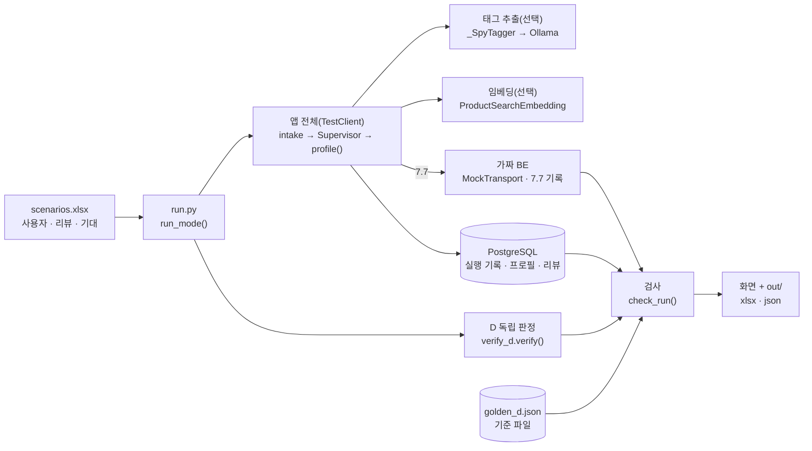
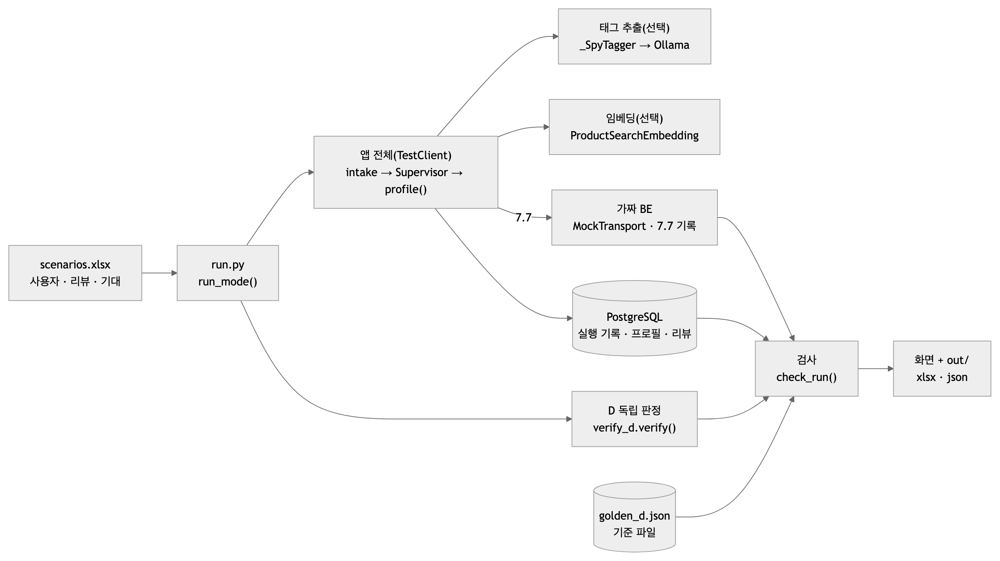
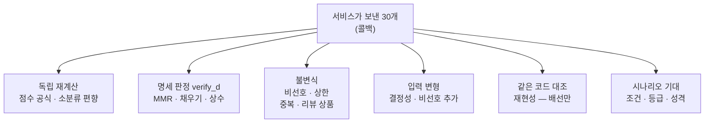
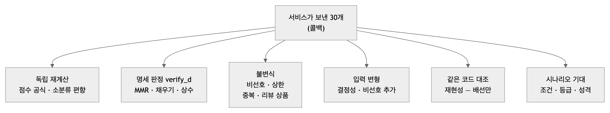

# 30개 콜백 검증 하네스 — 구조와 결과 (2026-10-12)

| | |
|---|---|
| 대상 | AI 저장소 `profiling/` — `feat/v2-profiling-init` @ `a637e45` + 작업 트리(D 코어 · 태그 추출 · 리뷰한 상품 미추천 · 하네스 개선, **미커밋**) |
| 하네스 | `tools/scenario_callback30/` — `run.py`(실행 · 검사 · 출력) · `verify_d.py`(D 독립 판정) · `scenarios.xlsx`(가상 사용자 10명 · 리뷰 · 태그 · 기대 45행) · `golden_d.json`(기준 파일) |
| 이번 판에서 바뀐 것 | ① **D 독립 판정**(selection 을 부르지 않고 명세 수식으로) ② **기대값을 설정별로**(조건 · 등급 · 성격) ③ **리뷰한 상품 미추천** 검사 ④ 입력 변형 · 기준 파일 |
| 결과 한 줄 | 세 설정 모두 **필수 검사 전부 통과**(태그 끔 448 · gemma4:12b 462 · qwen3.5:9b 462). 관찰(품질)은 gemma **44/44** · qwen **28/44** — 품질 차이가 계약 실패와 섞이지 않고 따로 보인다. 일부러 심은 D 버그 두 가지를 독립 판정이 **10/10 · 7/7** 잡았다(기존 재현성 검사는 둘 다 못 잡음) |

---

## 1. 구조

<!-- fig: 01-하네스-구조 -->




| 조각 | 하는 일 |
|---|---|
| `run_mode()` | 설정(태그 끔/켬 · 모델 · 임베딩)을 환경변수로 넣고 앱 전체를 띄운다. 사람마다 7.6 을 보내고, **진짜 `HttpBackendPort`가 보낸 7.7 요청**을 가짜 BE 가 받아 기록. 태그 추출기는 `_SpyTagger` 로 감싸 LLM 원출력을 기록(DB 엔 아직 태그 축 · 프롬프트판이 없어서 — 0006) |
| `check_run()` | 사람 × 모드마다 검사를 모은다 — 아래 §2 |
| `verify_d.verify()` | **`profiling.selection` 을 부르지 않고** 명세 수식(코어 공유 문서 §2 ⑤~⑧)만으로 콜백 30개를 판정 |
| `golden_d.json` | 태그 끔 · D 의 콜백 30개(10명 × 2모드). 다르면 의도된 변경인지 사람이 본다(`--save-golden` 으로 갱신) |

### 판정 방식 — 무엇이 무엇과 독립인가

<!-- fig: 02-판정-방식 -->




## 2. 검사 목록

| 묶음 | 검사 | 판정 방식 | 언제 |
|---|---|---|---|
| **자동(기본)** | 7.6 202 · 7.7 1회 · 경로 · 토큰 · 본문 계약(모르는 필드 금지) · 30개 · 중복 없음 · 카탈로그 · 재고 · 비선호(제외 0 / 감점 뒤에만 / D 는 모자랄 때만) · 한 소분류 ≤ 10 · 같은 모델 하나 · **리뷰한 상품 미추천** · 소분류 편향 독립 재계산 · 점수 공식 독립 재계산(오차 < 1e-9) · 저장 점수 · 리뷰 행 · 원문 미저장 · DELIVERED · 재현성(콜백 = 실행 기록 = `make_pool`) · (태그 켬) 저장 태그 = 원출력 재생성 | 독립 재계산 · 불변식 · (재현성만) 같은 코드 대조 | 언제나 |
| **D 독립 판정** | ① 상수 = 명세(λ 0.7 · 한 소분류 10 · 태그당 50 · 유사도 2 · 특징 ½) ② **MMR 단계**: 고른 상품마다 그 시점 받아들일 수 있는 후보 중 MMR 최대 ③ **채우기 단계**: 점수 순서 · 상한 → 상한 없이 → 비선호 | 명세 판정 | D 일 때(② 는 태그 있을 때) |
| **입력 변형** | 같은 입력 두 번 → 같은 30개 · 비선호 대분류 하나 추가 → 그 대분류 상품이 사라짐 | 관계 판정 | D 일 때(비선호가 이미 5개면 추가 생략) |
| **기대 — 필수** | 계약(비선호 대분류 0 · 모드간 동일 · 순위 앞섬) · 별점(1~2점 소분류 30개 밖) · 회귀(태그 끔: 5점 소분류 상위 10 · 조회수순) | 시나리오 | 조건이 맞을 때 |
| **기대 — 관찰** | 태그품질(태그 포함 · 제외 · 없음) · 취향(소분류 · 캐릭터 상품 개수) · 섞임(소분류 종수) · 회귀(기준 파일) | 시나리오 | 태그 켬(기준 파일은 태그 끔) |

**등급:** 필수가 하나라도 실패하면 하네스 실패(종료 코드 1, 통합 시험 실패). 관찰은 보고만 — 모델 · 프롬프트 품질 비교용.

## 3. 결과

### 3.1 설정별 요약 (20건 = 10명 × 제외 · 감점)

| 설정 | 필수 | 관찰 | 서버 처리 p75 · p90 · p95 · 최대 | 7.6 → 7.7 p95 |
|---|---|---|---|---|
| 태그 끔 | **448/448** | 20/20(기준 파일) | 17.9 · 18.4 · 19.0 · 19.2 ms | 23.1 ms |
| gemma4:12b | **462/462** | **44/44** | 13.4 · 14.1 · 15.3 · 16.2 초 | 15.3 초 |
| qwen3.5:9b | **462/462** | **28/44** | 6.6 · 6.8 · 7.2 · 7.9 초 | 7.2 초 |

필수가 태그 켬에서 14개 많은 이유: MMR 단계 독립 판정(태그 있는 7명 × 2모드).

### 3.2 검사 묶음별

| 묶음 | 태그 끔 | gemma4:12b | qwen3.5:9b |
|---|---|---|---|
| 자동(기본) | 330/330 | 348/348 | 348/348 |
| D 독립 · 상수 | 20/20 | 20/20 | 20/20 |
| D 독립 · MMR 단계 | — | 14/14 | 14/14 |
| D 독립 · 채우기 단계 | 20/20 | 20/20 | 20/20 |
| 입력 변형 | 38/38 | 38/38 | 38/38 |
| 필수 · 계약 | 10/10 | 10/10 | 10/10 |
| 필수 · 별점 | 12/12 | 12/12 | 12/12 |
| 필수 · 회귀(태그 끔) | 18/18 | — | — |
| 관찰 · 태그품질 | — | **26/26** | **16/26** |
| 관찰 · 취향 | — | **16/16** | **10/16** |
| 관찰 · 섞임 | — | 2/2 | 2/2 |
| 관찰 · 회귀(기준 파일) | 20/20 | — | — |

### 3.3 사람별 (감점 모드)

| 사람 | 태그 끔: 종수 / 최다 | gemma4:12b 태그 | 종수 / 최다 | qwen3.5:9b 태그 | 종수 / 최다 |
|---|---|---|---|---|---|
| U01 뷰티 | 10 / 향수 10 | 특징:은은한 향 · 향수 | 5 / 향수 10 | 특징:은은한 향 · 특징:산뜻함 | 9 / 향수 10 |
| U02 디지털 | 11 / 모바일·PC 10 | 특징:노이즈캔슬링 · 헤드폰 · 노트북 거치대 | 8 / 영상·음향 10 | 특징:노이즈캔슬링 · 특징:튼튼함 | 10 / 영상·음향 10 |
| U03 신생아 | 16 / 출산·육아 10 | 출산선물세트 · 특징:부드러운 소재 · 특징:백색소음 | 13 / 출산·육아 10 | 특징:부드러운 소재 · 특징:잠자기 좋은 기능 | 13 / 출산·육아 5 |
| U04 캐릭터 | 3 / 스포츠·레저 10 | IP:춘식이 · IP:한교동 · IP:산리오 | **17** / 생활가전 4 | IP:춘식이 · IP:한교동 | 15 / 정육·수산 4 |
| U05 홈카페 | 11 / 커피·차 10 | 특징:달달한 디저트 · 커피 · 케이크 · 차 선물세트 | 11 / 커피·차 10 | 디저트 · 커피 · 차 | 9 / 커피·차 10 |
| U06 콜드 스타트 | 21 / 3 | (없음) | 21 / 3 | 특징:실용적 | 15 / 6 |
| U07 까다로운 | 21 / 3 | (없음) | 21 / 3 | (없음) | 21 / 3 |
| U08 비선호 꽉 | 15 / 6 | (LLM 미호출) | 15 / 6 | (LLM 미호출) | 15 / 6 |
| U09 비선호 vs 리뷰 | 21 / 3 | 브랜드:조말론런던 · 향수 | 15 / **홈프래그런스 9** | **(없음 — 놓침)** | 21 / 3 |
| U10 엣지 | 17 / 영상·음향 10 | 브랜드:소니 · 헤드폰 | 8 / 영상·음향 10 | 특징:노이즈캔슬링 | 10 / 영상·음향 10 |

모든 실행에서 리뷰한 상품 0개 · 비선호 0개 · 한 소분류 ≤ 10 · 같은 모델 중복 0.

### 3.4 qwen3.5:9b 관찰 실패(두 모드 같음 — 8종 × 2)

| 사람 | 기대 | 실제 |
|---|---|---|
| U01 | 태그에 "향수" | 은은한 향 · 산뜻함 — 품목 없음 |
| U02 | 태그에 "노트북 · 거치대" | 노이즈캔슬링 · 튼튼함 |
| U02 | 모바일·PC 30개 중 3개 이상 | **0개** |
| U03 | 태그에 출산 · 아기 · 신생아 · 유아 | 부드러운 소재 · 잠자기 좋은 기능 |
| U03 | 출산·육아 30개 중 8개 이상 | 5개 |
| U09 | 태그에 향수 · 조말론 | **태그 없음** |
| U09 | 홈프래그런스 5개 이상 | 0개(태그가 없어 태그 없는 D 로) |
| U10 | 태그에 헤드폰 · 소니 | 노이즈캔슬링 |

공통 원인: 품목 · 브랜드 태그를 내지 않고 범용 특징만 냄 → 5점 신호를 잃음(로컬 LLM 시험 결과 §4.3 과 같음).

## 4. 하네스가 버그를 잡는가 — 일부러 심어 보기

| 심은 버그(코어는 그대로, 실행 중에만 바꿈) | 독립 판정 | 기존 재현성(콜백 = `make_pool`) |
|---|---|---|
| 채우기 순서 버그 — 결과의 21 · 22번째를 바꿈 | **10/10 잡음**(채우기 단계) | 10/10 통과 — 못 잡음(하네스도 같은 코드를 불러서 같이 틀림) |
| MMR 버그 — 이미 고른 것과의 중복 감점을 안 함(상수는 그대로) | **7/7 잡음**(MMR 단계, 태그 있는 사람 전부) | 통과 — 못 잡음 |

## 5. 판단과 남은 한계

- **D 의 "옳음"을 이제 독립적으로 판정한다** — 점수 계산(독립 재계산) + 고르는 순서(명세 판정) + 성질(불변식 · 입력 변형). 재현성 검사는 "배선이 끊기지 않았다"는 뜻으로만 남는다.
- **품질과 계약이 분리됐다** — 모델 · 프롬프트를 바꿔도 필수가 통과하면 서비스는 안전하고, 관찰 점수로 품질을 비교한다.
- 남은 한계

| 한계 | 영향 | 다음 |
|---|---|---|
| 저장 태그 검사가 같은 검증기를 두 번 돈다 | 검증기 자체의 버그는 못 잡음 | 태그품질 기대(관찰)가 일부 보완 · 0006 뒤 DB 값과 직접 대조 |
| "비선호로 채우기" · "상한 완화" 경로는 실제 카탈로그 시나리오에서 안 일어남 | 그 경로는 단위 시험만 | 작은 카탈로그 모드 또는 단위 시험 담당으로 명시 |
| LLM 실패 대체 경로가 하네스에 없음 | 단위 시험(가짜 추출기)만 | `--tagger-fail` 옵션 |
| 하네스와 통합 시험이 같은 시험용 수신자 번호대 | 동시에 돌리면 서로 지움 | 따로 실행(번호대 분리는 다음) |
| 관찰 문턱이 gemma 한 번 실측 기준 | 문턱의 근거가 약함 | 사람 검토 뒤 필수로 승격 |

## 6. 재현

```bash
cd profiling
uv run python -m tools.scenario_callback30.run                         # 태그 끔 — 448 필수 + 기준 파일 비교
uv run python -m tools.scenario_callback30.run --tagger ollama --tagger-model gemma4:12b --embedding-dir ../product-search
uv run python -m tools.scenario_callback30.run --tagger ollama --tagger-model qwen3.5:9b --embedding-dir ../product-search
uv run python -m tools.scenario_callback30.run --save-golden           # 의도된 변경 뒤 기준 파일 갱신
uv run pytest tests/integration/test_scenario_callback30.py -q          # 태그 끔 실행을 시험으로(관찰은 실패로 안 셈)
```

원자료: `tools/scenario_callback30/out/시나리오_결과_20261012_151213`(끔) · `151539`(gemma) · `151805`(qwen) `.{json,xlsx}`(커밋 안 함).
